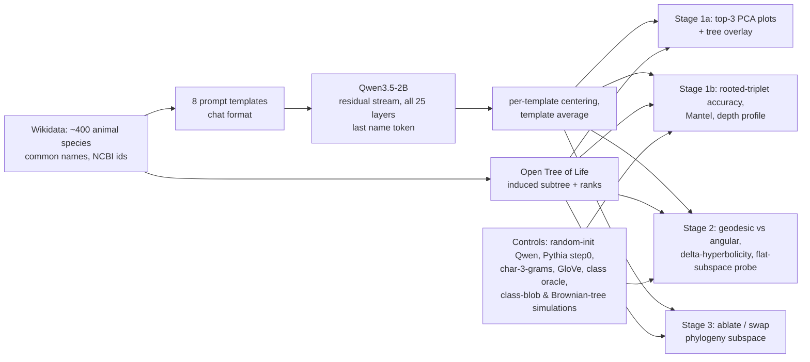

# Phylogenetic geometry of the tree of life in LLMs

**Do large language models arrange animal species along the tree of life?** This project reads the hidden states an LLM computes for about 400 animal species names (lion, house sparrow, honey bee, …). It then tests whether the geometry of those representations matches the phylogenetic tree of life, and what shape that geometry takes: tree, clusters, gradient, or curved manifold.

> **Status (2026-11-20): preregistered, no results yet.** The hypotheses, primary metric, analysis plan and falsification criteria are fixed in [`reports/preregistration.md`](reports/preregistration.md). They were committed before any activation was extracted.

## Motivation

- **Evo 2.** Goodfire found that Evo 2, a *DNA* foundation model, represents bacterial species on a curved "phylogenetic manifold": geodesic distances along it track evolutionary distance ([Goodfire 2025](https://www.goodfire.com/research/phylogeny-manifold)).
- **Neural geometry.** Goodfire's neural-geometry series shows concepts living on simple shapes in LLMs, such as days of the week on a circle ([index](https://www.goodfire.com/research/neural-geometry); [Engels et al. 2024](https://arxiv.org/abs/2405.14860); [Modell et al. 2025](https://arxiv.org/abs/2505.18235)).
- **The gap.** No peer-reviewed study has tested whether a *text* LLM's internal representations of species reflect the tree of life ([literature review](reports/literature-review.md)).
- **Why it is non-trivial.** Text carries phylogeny only indirectly. "Folk" categories (birds, fish, bugs), shared words ("X shark"), popularity and co-occurrence could all mimic a tree. The design is built to tell these apart.

## Method in one picture



1. **Species.** About 400 animals across 13 coarse groups (mammals … cnidarians). They are chosen by a fixed rule from Wikidata, with at most 3 per family, polysemous names such as "jaguar" excluded, and the list frozen with a hash.
2. **Reference tree.** The topology comes from the [Open Tree of Life](https://tree.opentreeoflife.org/) (CC0) and Linnaean ranks from the Open Tree Taxonomy. Divergence times come from [TimeTree 5](https://timetree.org/); they are used only for a secondary analysis and are not redistributed.
3. **Representations.**
   - Model: [Qwen3.5-2B](https://huggingface.co/Qwen/Qwen3.5-2B) (post-trained, bf16, fully on an 8 GB GPU).
   - Readout: the residual stream at the last token of the species name, for 8 prompts per species.
   - Each template is mean-centered, then the templates are averaged.
4. **Stage 1a, look first.** Following the neural-geometry practice, plot the **top 3 PCA directions** per layer and ask: *does it look like a tree?* The reference tree is overlaid in PC space, alongside calibration plots: days of the week (a circle), a random-init model, and a synthetic tree.
5. **Stage 1b, primary metric: rooted-triplet accuracy (TA).**
   - For species (a, b, c) where the tree says a and b are closer, check whether the representations agree. Chance is 1/3.
   - The primary test, TA_within, uses only triplets *inside* one coarse group whose names share no head noun. It is tested with layer-wise max-T permutations and family-block bootstrap CIs.
6. **Stage 2, geometry.**
   - Geodesic (kNN-graph) vs angular distance, as in Goodfire and Modell et al.
   - Gromov δ-hyperbolicity against matched nulls.
   - A neighbor-joining tree from the representations compared with the reference.
   - Goodfire's learned 10-d "flat subspace" probe, evaluated on held-out families with a shuffled-tree control.
7. **Later stages, in this order:**
   - **Stage 3:** causal and behavioral tests: ablation, interchange, steering, relatedness judgments.
   - **Stage 4:** ablations.
   - **Stage 5:** more models: scale and training dynamics with Qwen3.5-0.8B, Qwen3-1.7B and Pythia checkpoints.
   - **Stage 6:** sensitivity: seeds, templates, species subsamples.

The full run matrix is in [`reports/planned-runs.md`](reports/planned-runs.md).

## What would count as a positive or negative result (preregistered)

| Outcome | Meaning |
|---|---|
| Within-group triplet accuracy above chance, the untrained models and the lexical baselines | Phylogenetic structure beyond folk categories |
| Also above chance on lexical- and co-occurrence-discordant triplets | Structure beyond word overlap and co-occurrence |
| Only the global correlation is significant | Folk-category clusters only |
| Conflict triplets (whale–hippo vs whale shark; starfish–human vs octopus) follow the folk partner | Folk taxonomy rather than phylogeny |

## Repository layout (being built)

```
src/phylogeo/     package: data (species, tree, baselines), prompts, extract, geometry,
                  stats (mantel, triplets, resample), treeness, probes, causal, viz, report
tests/            pytest suite (statistical ground truths, extraction checks)
configs/          YAML run configs (one per stage)
reports/          literature review, preregistration, run matrix, experiments, reviews, paper
results/          raw results (JSON/CSV); large arrays live on Hugging Face
logs/             timestamped run logs
```

## Setup

The commands below use `uv` and are written in PowerShell.

```powershell
uv sync
```

```powershell
Copy-Item .env.example .env
```

Edit `.env` so that `HF_HOME` and `DATA_DIR` point to a drive with space. PyTorch comes from the CUDA 13.2 wheel index configured in `pyproject.toml`, which supports Blackwell GPUs (sm_120).

Running instructions will be added here once the pipeline is implemented.

## Data and models on Hugging Face

- Collection: [Phylogenetic geometry of the tree of life in LLMs](https://huggingface.co/collections/BurnyCoder/phylogenetic-geometry-of-the-tree-of-life-in-llms-6afffc252e04f452d5e7d905)
- Frozen species set, Open Tree trees and conflict triplets: [BurnyCoder/phylogenetic-geometry-species](https://huggingface.co/datasets/BurnyCoder/phylogenetic-geometry-species)

## Documentation

- [Literature review](reports/literature-review.md) · [State-of-the-art methods review](reports/state-of-the-art-review.md)
- [Preregistration](reports/preregistration.md) · [Planned runs](reports/planned-runs.md) · [Plan](reports/plan.md) · [Progress](reports/progress.md)

## To-do
- [x] Literature and state-of-the-art review
- [x] Preregistration and run matrix
- [ ] Tests and core implementation
- [ ] Freeze species set and reference tree; power simulation
- [ ] Stage 1a: top-3 PCA plots ("do they look like a tree?")
- [ ] Stage 1b: triplet accuracy, Mantel, controls, conflict triplets
- [ ] Stage 2: probes, geodesic, δ-hyperbolicity, neighbor-joining
- [ ] Stage 3: causal and behavioral tests (subspace ablation / interchange, steering, relatedness judgments)
- [ ] Stage 4: ablations (prompt format, readout, distance variants, binomial names, polysemous names, dated tree)
- [ ] Stage 5: more models (Qwen3.5-0.8B, Qwen3-1.7B, Pythia scale and training checkpoints)
- [ ] Stage 6: sensitivity (probe seeds, template subsets, species subsamples, kNN / dimension sweeps)
- [ ] Paper, interactive website (GitHub Pages), Hugging Face collection

*Author: Libor "Burny" Burian.*
