# Phylogenetic geometry of the tree of life in LLMs

**Do large language models arrange animal species along the tree of life?** This project reads the hidden states that [Qwen3.5-2B](https://huggingface.co/Qwen/Qwen3.5-2B) computes for 400 animal species names (lion, house sparrow, honey bee, …). It tests, with preregistered statistics and strong controls, whether the geometry of those representations matches the phylogenetic tree, and what shape it takes: tree, clusters, gradient or curved manifold.

The design follows Goodfire's work:
- **Evo 2 phylogeny manifold.** The DNA model Evo 2 represents bacteria on a curved manifold whose geodesics track evolutionary distance ([Goodfire 2025](https://www.goodfire.com/research/phylogeny-manifold)).
- **Neural geometry.** Concepts such as days of the week sit on simple shapes inside LLMs ([Goodfire neural geometry](https://www.goodfire.com/research/neural-geometry); [Engels et al. 2024](https://arxiv.org/abs/2405.14860); [Modell et al. 2025](https://arxiv.org/abs/2505.18235)).

This project asks the same questions of a *text* LLM. Text carries phylogeny only indirectly, so the main work is ruling out shortcuts that can mimic a tree:
- folk categories (birds, fish, bugs);
- shared words ("tiger shark", "whale shark");
- name length and popularity;
- co-occurrence statistics.

## Visual summary

Ground truth (the reference tree), positive results and negative results, each labelled with its verdict. Blue = this model, gray = untrained networks, orange = name statistics, aqua = ground-truth references. The first two animations show tree order inside groups and colour taxonomic orders instead (key in each row header).

<!-- WITHIN3D:START -->
<p align="center"><b>Tree order inside groups, in 3-D: trained vs random weights, with the tree fitted in</b> (animated here; interactive on the site)<br>🟡 mixed: beats random weights in 2/4 groups in 3-D (birds, mammals), in 0/4 in all dimensions (per-group CIs)</p>

<p align="center"><a href="https://burnycoder.github.io/phylogenetic-geometry-of-tree-of-life-in-llms-mechanistic-interpretability/#fig-within3d"></a><br><b>Through the layers: both networks sweep layers 0 → 24 (the perfect tree code has no layers); each title shows that layer's numbers</b></p>

<p align="center"><a href="https://burnycoder.github.io/phylogenetic-geometry-of-tree-of-life-in-llms-mechanistic-interpretability/#fig-within3d">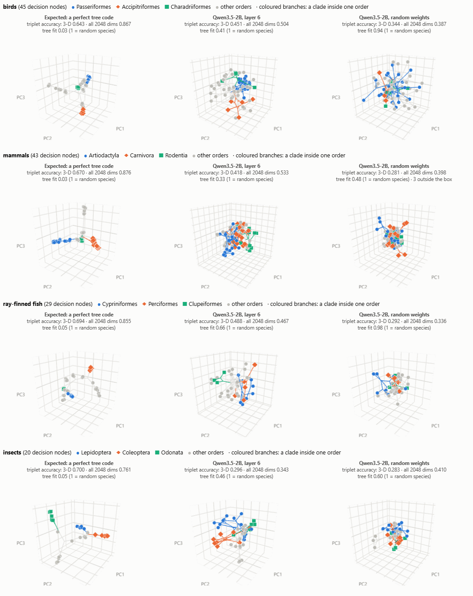</a><br><b>At the H1 layer (6), rotating; the table below is at this layer</b></p>

*Generated by `python -m phylogeo.run --phases viz_data,site` from `results/`; post hoc, descriptive.* In the layer sweep, each layer has its own projection; consecutive layers are rotated onto each other (orthogonal Procrustes, display only) and positions are interpolated between layers, so the clouds move smoothly instead of flipping axes. Groups: every group with at least 20 decision nodes in the H1 test (one row each in the static view). Left: a perfect tree code (Brownian motion on the reference tree), middle: Qwen3.5-2B at layer 6 (the H1 layer), right: the same network with random weights. Every panel goes through one pipeline: species vectors scaled to unit length (the geometry the cosine-based H1 test scores), centred on the group, top three principal components. Colours: the group's three largest orders; gray: all other orders. Lines: the reference tree fitted into the points (phylomorphospace: internal nodes where the total squared branch length is smallest, i.e. Brownian-motion ancestral states); branches inside one coloured order wear its colour. Titles give the triplet accuracy of the 3-D picture and of all 2048 dimensions (chance 1/3), and the tree fit: squared length of the fitted tree over its mean across 999 shuffles of the species (1 = no better than a random assignment). The tree fit uses every species, including names that share a head noun ("… beetle"), so shared words can lower it even in the random-weight network; the triplet accuracies exclude such names, as H1 does. Three dimensions keep only part of the order, even for the perfect tree code. Internal-node placement follows squared-change parsimony ([Maddison 1991](https://search.r-project.org/CRAN/refmans/castor/html/asr_squared_change_parsimony.html)) as in phylomorphospace plots ([Sidlauskas 2008](https://doi.org/10.1111/j.1558-5646.2008.00519.x); phytools `phylomorphospace3d`, [Revell 2012](https://doi.org/10.1111/j.2041-210X.2011.00169.x)).

| group (decision nodes) | triplet accuracy, 3-D view: trained / random weights [difference, 95% CI] | all 2048 dimensions: trained / random weights [difference, 95% CI] | tree fit, lower = better: perfect tree / trained / random weights |
|---|---|---|---|
| birds (45) | 0.451 / 0.344 [+0.057, +0.223] | 0.504 / 0.387 [-0.034, +0.252] | 0.03 / 0.41 / 0.94 |
| mammals (43) | 0.418 / 0.281 [+0.031, +0.266] | 0.533 / 0.398 [-0.025, +0.291] | 0.03 / 0.33 / 0.48 |
| ray-finned fish (29) | 0.488 / 0.292 [-0.001, +0.357] | 0.467 / 0.336 [-0.176, +0.281] | 0.05 / 0.66 / 0.98 |
| insects (20) | 0.296 / 0.283 [-0.111, +0.211] | 0.343 / 0.410 [-0.174, +0.193] | 0.05 / 0.46 / 0.60 |

CIs: paired family-block bootstrap (1000 draws) of trained minus random weights, on the H1 triplets of each group. The difference excludes zero in 2 of 4 groups in the 3-D view and in 0 of 4 in all 2048 dimensions. Group by group, the picture therefore shows the separation more sharply than the full space does; the confirmatory evidence is the registered H1 test, which pools all groups (key-results table below).
<!-- WITHIN3D:END -->

<!-- FIGURES:START -->
*Generated by `python -m phylogeo.run --phases viz_data,site` from `results/`; click a figure for the interactive version on the [project site](https://burnycoder.github.io/phylogenetic-geometry-of-tree-of-life-in-llms-mechanistic-interpretability/) (hover, zoom, toggle series).*

<p align="center"><a href="https://burnycoder.github.io/phylogenetic-geometry-of-tree-of-life-in-llms-mechanistic-interpretability/#fig-pca3d"></a><br><b>Top-3 principal components in 3-D, animated through all layers: trained vs random init</b> (animated here; interactive 3-D player on the site)<br>🟡 mixed: trained: H1a checks pass in 23/25 layers, already at near-lexical layer 2, so they do not discriminate; by eye: class arms, no nested branching</p>

<table>
<tr><td width="50%" valign="top"><a href="https://burnycoder.github.io/phylogenetic-geometry-of-tree-of-life-in-llms-mechanistic-interpretability/#fig-taxonomy"></a><br><b>Ground truth: the 400 species on the tree of life</b><br>🔷 ground truth: reference</td><td width="50%" valign="top"><a href="https://burnycoder.github.io/phylogenetic-geometry-of-tree-of-life-in-llms-mechanistic-interpretability/#fig-heatmaps"></a><br><b>Expected vs observed: who is close to whom</b><br>🔷 ground truth: ground truth vs observed</td></tr>
<tr><td width="50%" valign="top"><a href="https://burnycoder.github.io/phylogenetic-geometry-of-tree-of-life-in-llms-mechanistic-interpretability/#fig-pca_expected">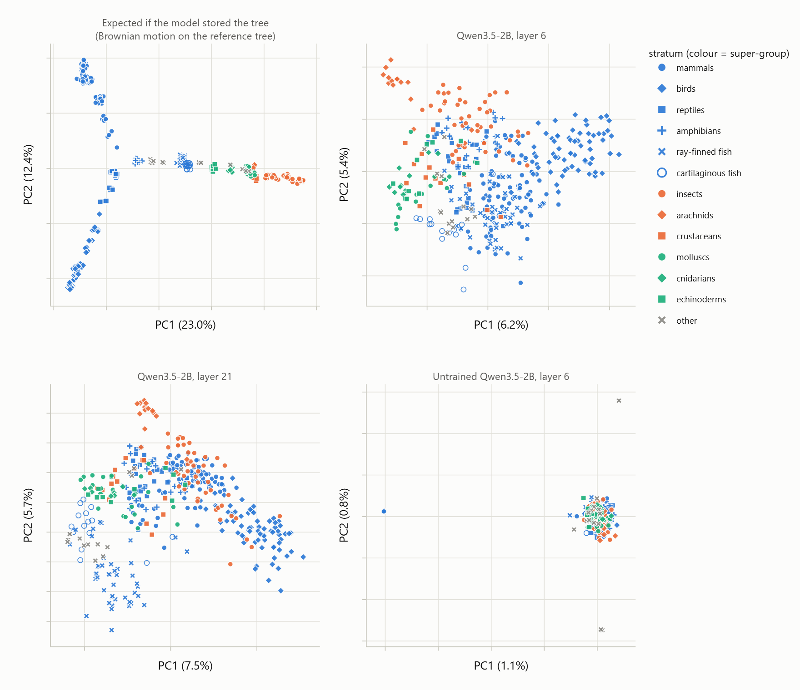</a><br><b>Expected vs observed shape in the top two principal components</b><br>🟡 mixed: class arms, no visible nested tree</td><td width="50%" valign="top"><a href="https://burnycoder.github.io/phylogenetic-geometry-of-tree-of-life-in-llms-mechanistic-interpretability/#fig-h1">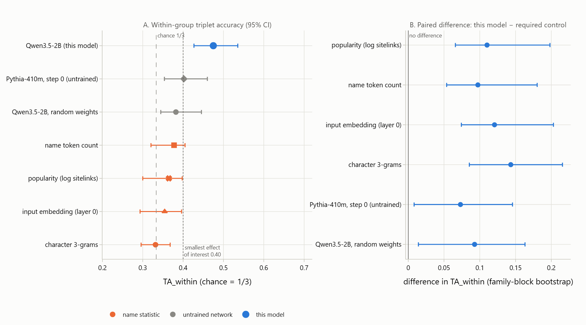</a><br><b>Primary test (H1): tree order inside coarse groups</b><br>✅ positive: H1 supported (max-T p 0.001)</td></tr>
<tr><td width="50%" valign="top"><a href="https://burnycoder.github.io/phylogenetic-geometry-of-tree-of-life-in-llms-mechanistic-interpretability/#fig-within3d"></a><br><b>Tree order inside groups, in 3-D: trained vs random weights, with the tree fitted in</b><br>🟡 mixed: beats random weights in 2/4 groups in 3-D (birds, mammals), in 0/4 in all dimensions (per-group CIs)</td><td width="50%" valign="top"><a href="https://burnycoder.github.io/phylogenetic-geometry-of-tree-of-life-in-llms-mechanistic-interpretability/#fig-layers"></a><br><b>Across layers: when does tree order appear?</b><br>✅ positive: peaks at layer 6 of 24 (25% depth)</td></tr>
<tr><td width="50%" valign="top"><a href="https://burnycoder.github.io/phylogenetic-geometry-of-tree-of-life-in-llms-mechanistic-interpretability/#fig-strata">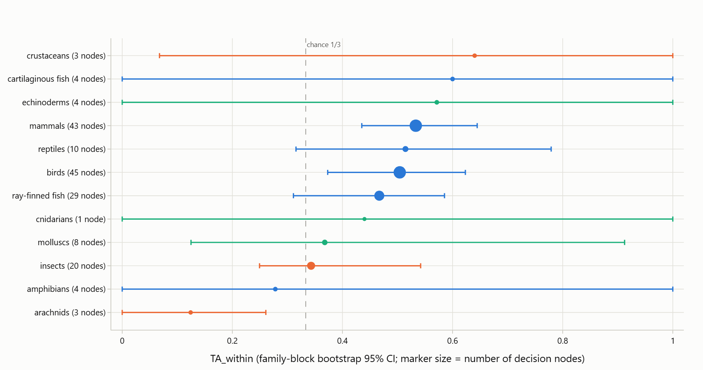</a><br><b>Which groups carry the signal?</b><br>🟡 mixed: clear in birds, mammals; below chance in arachnids (3 nodes)</td><td width="50%" valign="top"><a href="https://burnycoder.github.io/phylogenetic-geometry-of-tree-of-life-in-llms-mechanistic-interpretability/#fig-depth"></a><br><b>Where on the tree is the model right? Accuracy by depth of the split</b><br>🟡 mixed: largest gain between classes, smaller inside orders</td></tr>
<tr><td width="50%" valign="top"><a href="https://burnycoder.github.io/phylogenetic-geometry-of-tree-of-life-in-llms-mechanistic-interpretability/#fig-neighbor_levels"></a><br><b>Nearest neighbours: how closely related are they?</b><br>✅ positive: far more same-order neighbours than untrained</td><td width="50%" valign="top"><a href="https://burnycoder.github.io/phylogenetic-geometry-of-tree-of-life-in-llms-mechanistic-interpretability/#fig-neighbor_examples"></a><br><b>Output examples: the 5 nearest species</b><br>⚪ example: rule-chosen queries (one per stratum)</td></tr>
<tr><td width="50%" valign="top"><a href="https://burnycoder.github.io/phylogenetic-geometry-of-tree-of-life-in-llms-mechanistic-interpretability/#fig-secondary">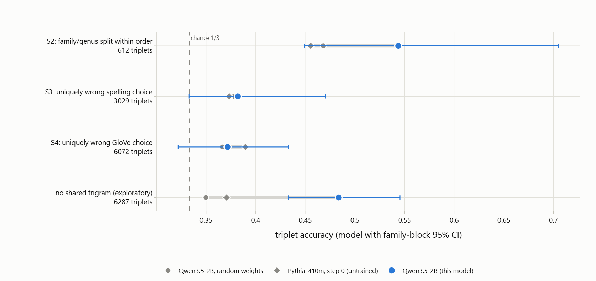</a><br><b>Beyond spelling and co-occurrence? Model vs untrained networks</b><br>❌ negative: S2–S4 matched by untrained networks</td><td width="50%" valign="top"><a href="https://burnycoder.github.io/phylogenetic-geometry-of-tree-of-life-in-llms-mechanistic-interpretability/#fig-conflict"></a><br><b>Phylogeny-vs-folk conflict triplets (ground truth in bold)</b><br>❌ negative: tree partner in 11/36, like untrained networks</td></tr>
<tr><td width="50%" valign="top"><a href="https://burnycoder.github.io/phylogenetic-geometry-of-tree-of-life-in-llms-mechanistic-interpretability/#fig-probe">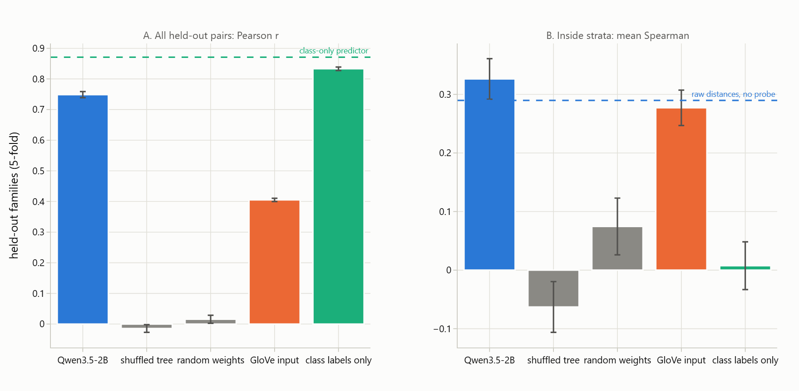</a><br><b>Goodfire-style 10-d flat probe: tree or coarse groups?</b><br>❌ negative: class-only input does as well</td><td width="50%" valign="top"><a href="https://burnycoder.github.io/phylogenetic-geometry-of-tree-of-life-in-llms-mechanistic-interpretability/#fig-treeness">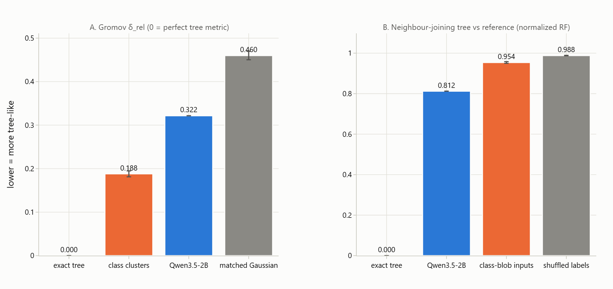</a><br><b>Is the geometry tree-like (hyperbolic)?</b><br>❌ negative: between clusters and noise</td></tr>
<tr><td width="50%" valign="top"><a href="https://burnycoder.github.io/phylogenetic-geometry-of-tree-of-life-in-llms-mechanistic-interpretability/#fig-causal"></a><br><b>Causal tests: does the model use the probe subspace?</b><br>🟡 mixed: C-swap ✓, C-abl ✗, not phylogeny-specific</td><td width="50%" valign="top"><a href="https://burnycoder.github.io/phylogenetic-geometry-of-tree-of-life-in-llms-mechanistic-interpretability/#fig-habitat">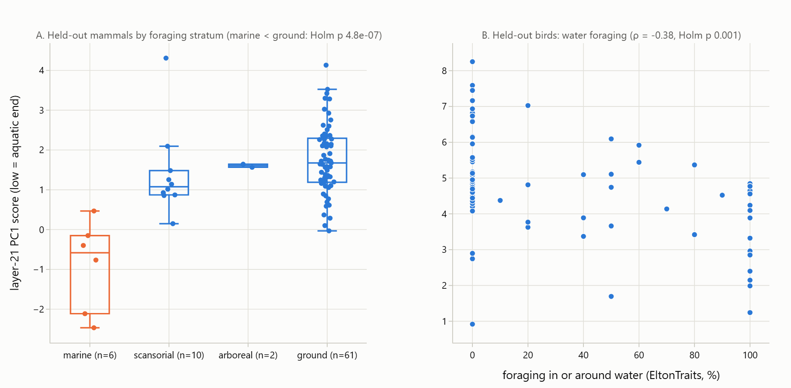</a><br><b>Addendum A: an aquatic-to-terrestrial axis, tested on held-out species</b><br>🟡 mixed: aquatic end confirmed, aerial end not confirmed</td></tr>
<tr><td width="50%" valign="top"><a href="https://burnycoder.github.io/phylogenetic-geometry-of-tree-of-life-in-llms-mechanistic-interpretability/#fig-scale">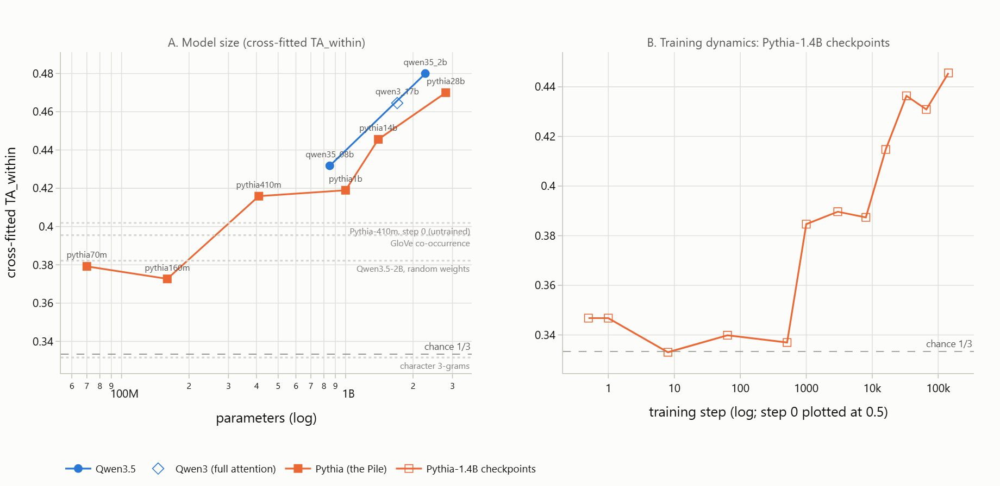</a><br><b>More models: grows with scale, learned during training</b><br>✅ positive: descriptive (stage 5)</td><td width="50%" valign="top"><a href="https://burnycoder.github.io/phylogenetic-geometry-of-tree-of-life-in-llms-mechanistic-interpretability/#fig-sensitivity">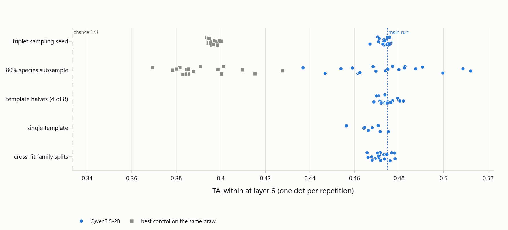</a><br><b>Sensitivity: seeds, templates, species subsamples</b><br>✅ positive: robust</td></tr>
</table>
<!-- FIGURES:END -->

## Highlights

**Positive results**
- **Some tree order inside groups, beyond the registered shortcuts.** Within coarse groups, Qwen3.5-2B places species closer to their tree relatives more often than chance would. It also beats every preregistered control:
  - two untrained networks: random-init Qwen3.5-2B and Pythia-410m at step 0;
  - name spelling (character 3-grams);
  - name token count;
  - Wikipedia popularity.

  This was the single primary hypothesis, and it is **supported**.
  - **Size.** The effect is modest: the margin over the strongest control is small (generated table below).
  - **Where.** It is clear only in mammals and birds, the two largest groups. In ray-finned fish and insects the CI includes chance; the other groups have very few branching points. Arachnids score below chance, but on only 3 branching points.
  - **Robustness.** It holds across 20 triplet seeds, 80% species subsamples, template subsets and single prompt templates (stage 6).
  - **Fragility (independent audit, post hoc).** The margin over the two untrained networks excludes zero with the registered family-level bootstrap. It does not when whole taxonomic orders are resampled instead (generated table below).
  - **Lexically neutral triplets (post hoc).** On triplets whose names share no character 3-gram, the model beats the untrained networks, and the untrained networks are at chance there.
  - **See it in 3-D (post hoc).** At the top of the [Visual summary](#visual-summary), each large group is shown as a point cloud: a perfect tree code, the trained model and the same network with random weights, all through one pipeline, with the reference tree fitted into every cloud.

- **The dominant late-layer direction mixes ecology with taxonomy.** The top principal component orders animals from aquatic to terrestrial. It is confirmed out of sample on 159 new species (preregistered addendum): whales and seals sit toward fish, and waterbirds sit apart from other birds. Caveats: this component holds only a few percent of the variance, and names with water words were not controlled.
- **Calibration.** Days of the week and months form closed loops in calendar order with the same pipeline (judged by eye), consistent with the circles of [Engels et al.](https://arxiv.org/abs/2405.14860).

**Negative results** (including preregistered predictions that failed)
- **Not robust to misleading spelling or co-occurrence.** The effect is not significant on triplets where name spelling or GloVe co-occurrence points the wrong way. On those triplets the model does no better than untrained networks (S3 and S4 not supported). Spelling alone does not explain the effect: post hoc, it holds where spelling carries no information. Co-occurrence is not ruled out.
- **Order within taxonomic orders is matched by an untrained network.** S2 passes its registered test against chance, but random-init Qwen scores the same.
- **No time signal detected.** Distances do not track divergence *time* beyond tree topology (S5 not supported). That test has low power by design.
- **Conflict cases do not follow the tree, and neither do untrained networks.** Where phylogeny and folk categories disagree (whale: hippo or whale shark? starfish: human or octopus?), the geometry picks the tree-closer animal in only a minority of cases. The untrained networks behave the same, so this is not evidence of a learned folk taxonomy.
- **The flat-subspace probe mostly measures coarse groups.**
  - Goodfire's 10-d probe predicts tree distances on held-out families well, but the same probe on a *class-only* input does at least as well.
  - Within groups, on the same held-out pairs, the raw distances without any probe keep more tree order than the probe does (independent audit).
  - "A linear subspace carries the tree" is therefore not supported.
- **No visible tree.** The top-3 PCA plots show class "arms" plus a habitat gradient, not a nested tree.
- **No hyperbolic or geodesic advantage.** A hyperbolic (Poincaré) probe is never better than the best flat (Euclidean) probe, and kNN-geodesic distances do not order triplets better than plain angles.
- **Latin binomials carry much weaker structure,** and only in late layers. The tree order is tied to vernacular names.
- **No phylogeny-specific causal role.** These are interventions on the 10-d probe subspace at one layer, on held-out species.
  - Swapping the subspace between species switches the class answer more often than swapping any of 99 random subspaces (C-swap supported), but only in a small share of pairs.
  - Ablating it does not beat the random subspaces (C-abl not supported).
  - A probe trained only on class membership does as well on both tests. The subspace is used for coarse class answers; nothing shows that within-group tree structure is used.

The headline numbers below are generated from `results/` by the report script.

<!-- KEY-RESULTS:START -->
*Qwen3.5-2B unless noted. Generated by `python -m phylogeo.run --phases report` from `results/`; do not edit by hand.*

| Question | Result | Verdict |
|---|---|---|
| Tree order *within* coarse groups, beyond untrained networks, spelling, name length and popularity (H1, primary) | TA_within at layer 6 = 0.475 [95% CI 0.427, 0.535], cross-fitted 0.473; max-T p 0.001 (permutation floor); margin over the strongest required control (pythia410m_step0, 0.402) +0.073 [+0.008, +0.146]; chance 0.333 | supported |
| Are the untrained networks themselves above chance? (own max-T test over layers) | qwen35_2b_random: max-T p 0.129, cross-fitted 0.354, 0.382 at its selected layer; pythia410m_step0: max-T p 0.007, cross-fitted 0.380, 0.402 at its selected layer | qwen35_2b_random no; pythia410m_step0 yes |
| Where the within-group signal is (post hoc) | birds 0.504 [0.373, 0.623], 45 nodes; mammals 0.533 [0.435, 0.645], 43 nodes; the other strata have few decision nodes and wide CIs | clear only in the two largest strata |
| Global distance correlation with the tree (S1) | Mantel r = 0.362, Holm p 0.005; class oracle alone 0.508, log popularity alone 0.296 | supported (not specific to phylogeny) |
| Order within taxonomic orders (S2) | TA = 0.445, Holm p 0.005; untrained: qwen35_2b_random 0.451, pythia410m_step0 0.424 | supported vs chance; not above the untrained controls |
| Survives when spelling points the wrong way (S3) | TA = 0.382, Holm p 0.360; untrained: qwen35_2b_random 0.379, pythia410m_step0 0.375 | not supported |
| Survives when GloVe co-occurrence points the wrong way (S4) | TA = 0.372, Holm p 0.360; untrained: qwen35_2b_random 0.367, pythia410m_step0 0.390 | not supported |
| Lexically neutral triplets: character 3-grams pick no pair (post hoc; 6287 of 6306 share no character 3-gram) | TA = 0.484 (n = 6306); qwen35_2b_random 0.350, diff CI [+0.047, +0.209], pythia410m_step0 0.371, diff CI [+0.036, +0.184]; untrained networks' own CIs qwen35_2b_random [0.313, 0.418], pythia410m_step0 [0.328, 0.436] | above the untrained controls; the untrained networks are at chance here |
| Distances track divergence time beyond topology (S5) | partial Spearman 0.042, Holm p 0.360 | not supported (no time signal detected; low power by design) |
| Phylogeny-vs-folk conflict triplets (whale: hippo or whale shark?) | tree-closer partner chosen in 11/36 (binomial p 0.029); untrained: qwen35_2b_random 13/36 (McNemar p 0.804); pythia410m_step0 13/36 (McNemar p 0.774); char3 9/36 (McNemar p 0.804) | geometry does not follow the tree here; no evidence the trained model differs from untrained networks |
| Learned 10-d flat subspace (Goodfire-style probe; exploratory) | held-out r = 0.749, within-stratum 0.326; shuffled tree -0.015; class-only (class-blob) input 0.833, within-stratum 0.008; raw angular distances without a probe on the same held-out pairs, within-stratum 0.401 | all-pairs r reflects coarse groups; within strata the probe does not add order over raw distances (it scores lower) |
| Tree-like (hyperbolic) metric (exploratory) | Gromov δ_rel = 0.322 vs matched Gaussian 0.460, class-blob 0.188, exact tree 0 | does not separate trees from clusters |
| Ablating the probe subspace hurts class answers more than random subspaces (C-abl) | drop 0.083 vs 0.027 nats; rank p 0.120, Holm 0.120 | not supported |
| Swapping the subspace switches the class answer (C-swap) | switch rate 0.055 vs random mean 0.025; rank p 0.010, Holm 0.020; no edit 0.020 (200 pairs) | supported (small effect) |
| Causal role specific to phylogeny, beyond class (vs class-only subspace) | ablation drop 0.083 vs 0.146 (p 0.966); switches 0.055 vs 0.060 (p 0.773) | no |
| The model *says* which species are related (exploratory) | chooses the tree-closer animal in 0.567 of 300 within-group triplets (binomial p 0.024, triplets not independent); agreement with the representation 0.633 vs 0.515 expected if independent | weak |
| Latin binomials carry the same structure (exploratory) | head-noun-disjoint genus-split triplets: binomials 0.320 (best layer 0.380) vs common names 0.476 | much weaker |
| Late-layer top PC orders aquatic → terrestrial (Addendum A, held-out species) | marine vs ground mammals (n = 6) Holm p 3.6e-07; waterbird ρ = -0.385 (Holm p 4.2e-04); aerial birds ρ = -0.157 (Holm p 0.917) | aquatic end supported (name cues not controlled), aerial end not |
| Is the H1 margin stable? (audit, post hoc) | lowest lower CI bound over 5 extra family-block bootstrap seeds: pythia410m_step0 +0.001; with orders as blocks (118 orders instead of 258 families): qwen35_2b_random [-0.009, +0.121], pythia410m_step0 [-0.014, +0.124] | passes with the registered family blocks (in all 5 seeds); not with order blocks vs qwen35_2b_random, pythia410m_step0 |
| Robust to seeds, template subsets, species subsamples (stage 6) | lowest TA_within over 20 repetitions of each perturbation 0.437; smallest margin over the best control 0.044 | robust |
| Other models (stage 5; cross-fitted TA_within with 10 family splits, so qwen35_2b differs slightly from the H1 row, which uses 20) | pythia70m 0.379; pythia160m 0.373; pythia410m 0.416; qwen35_08b 0.432; pythia1b 0.419; pythia14b 0.446; qwen3_17b 0.465; qwen35_2b 0.480; pythia28b 0.470 | descriptive |

Exploratory p-values are corrected with BH-FDR over the 178 registered exploratory tests; q-values are in `results/RESULTS.md`.
<!-- KEY-RESULTS:END -->

| Top-3 PCA, layer 21 (one panel per group, highlighted against all species) | Within-group triplet accuracy by layer, vs controls |
|---|---|
| 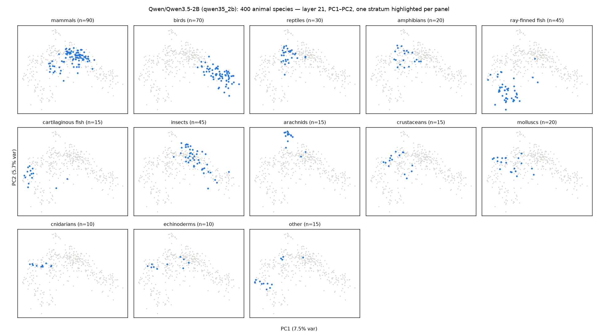 |  |
| **Flat-subspace probe, held-out families** | **Days of the week (calibration: a circle)** |
|  |  |

An interactive 3D version of the PCA view, with a layer slider and hover names, is at [`results/qwen35_2b/stage1a/pca3d.html`](results/qwen35_2b/stage1a/pca3d.html). The website also has an **animated 3-D player** (the GIF at the top of this README). It shows the trained model **next to its random-init twin**, both driven by one layer clock through all 25 layers. Positions are interpolated between consecutive layers, which are aligned by orthogonal Procrustes. The two cameras are linked, the panels share one box per layer, and outlier names outside the box are counted in the title. There is also a tree overlay, and the right panel can show the expected shape of a true tree code instead.

## What is new

According to the [literature review](reports/literature-review.md), no study had tested a text LLM's hidden states for species names against a phylogeny. Prior work probes lexical (WordNet-style) taxonomies that include animal categories, mostly in unembeddings or through behaviour, e.g. [Park et al. 2025](https://arxiv.org/abs/2406.01506), [Nava & Wyart 2026](https://arxiv.org/abs/2605.23821) and [Sun et al. 2024](https://arxiv.org/abs/2406.11131). The closest related work:
- a student project (Princeton COS398) that found sentence embeddings uncorrelated with the mammal tree ([phylotext-mammals](https://github.com/jadencutinha/phylotext-mammals));
- a small repository with 87 organisms from five kingdoms ([llm_internal_representations](https://github.com/alexgarciaduran/llm_internal_representations)).

This project adds:
1. **A preregistered within-group metric.** Node-balanced rooted-triplet accuracy that is immune to class-level clustering, with untrained-network, lexical, popularity and co-occurrence controls.
2. **Goodfire's flat-subspace probe in a text LLM,** with family-held-out evaluation, a shuffled-tree control and a class-only control. The class-only control shows that the probe's headline correlation mostly reflects coarse groups, a caveat that also applies to similar probes elsewhere.
3. **Causal tests.** The probe subspace is ablated and swapped against 99 variance-matched random subspaces and a class-only subspace.
4. **An out-of-sample test of a post-hoc observation.** The habitat axis was turned into a preregistered addendum and tested on new species.

## Method

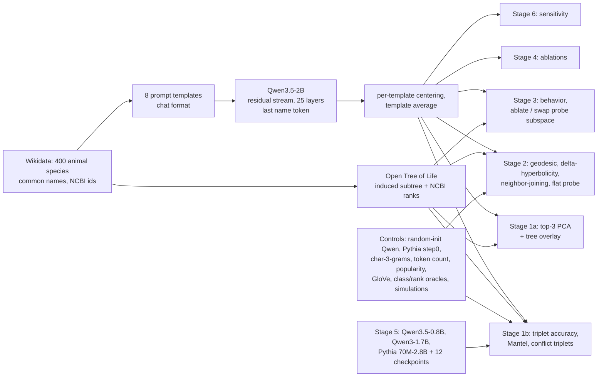

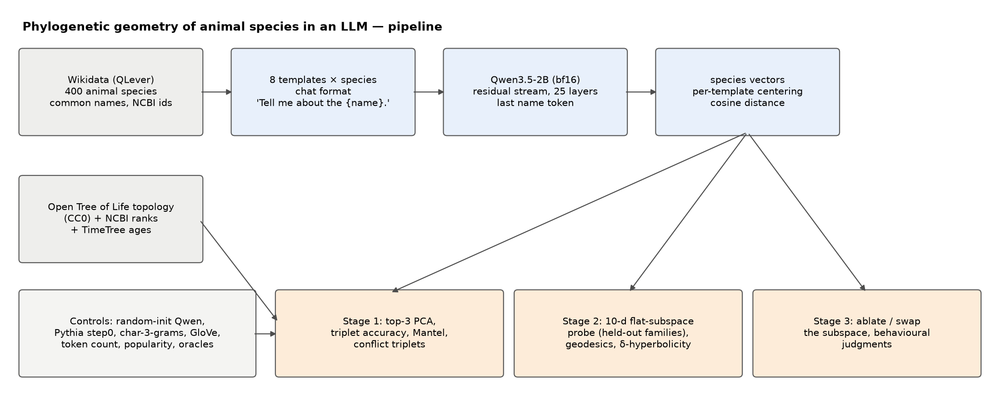

### Data
- **Species.** 400 animals across 13 coarse groups (strata), selected by a fixed rule from Wikidata via the [QLever endpoint](https://qlever.dev/wikidata):
  - the English Wikipedia title is the common name;
  - each has an NCBI taxon id and an Open Tree match;
  - at most 3 per family;
  - polysemous names such as "jaguar" are excluded.

  The list is frozen with sha256 hashes in [`data/FREEZE.json`](data/FREEZE.json).
- **Reference tree.** The induced subtree of the [Open Tree of Life](https://tree.opentreeoflife.org/) (CC0), with ranks from the [NCBI Taxonomy](https://www.ncbi.nlm.nih.gov/taxonomy). Divergence times come from [TimeTree 5](https://timetree.org/); they are used only for S5, cached locally and not redistributed.
- **Conflict triplets.** 36 hand-curated triplets where phylogeny and folk categories disagree ([`data/conflict_triplets.csv`](data/conflict_triplets.csv)).
- **Held-out habitat set.** 79 mammals and 80 birds, with foraging strata from [EltonTraits 1.0](https://esapubs.org/archive/ecol/E095/178/).

### Representations
- **Model.** [Qwen3.5-2B](https://huggingface.co/Qwen/Qwen3.5-2B), the post-trained release, pinned revision. It is a hybrid of Gated-DeltaNet and full-attention layers (24 layers, d = 2048), run in bf16 on one 8 GB GPU with batch size 1.
- **Prompts.** 8 templates in the chat format, e.g. "My favorite animal is the {name}."
- **Readout.** The residual stream at the last token of the name, at every layer.
- **Normalization.** Each template is mean-centered over species, then the templates are averaged. Distance is cosine.

### Evaluation
- **Primary metric (H1): TA_within.**
  - Rooted-triplet accuracy on triplets (a, b | c) whose decision node lies inside one stratum and whose three names share no head noun.
  - At most 200 triplets per tree node, so no single clade dominates. Chance is 1/3.
  - Tested with a max-T permutation over layers (species shuffled within strata), family-blocked cross-fitting for layer choice, and a family-block bootstrap CI.
  - H1 requires beating the fixed control set listed under Highlights.
- **Secondary hypotheses (Holm-corrected).** S1 Mantel, S2 order-level TA, S3 lexical-discordant TA, S4 co-occurrence-discordant TA, S5 divergence time vs topology.
- **Causal hypotheses (Holm family of 2).** Ablation and interchange of the probe subspace (stage 3).
- Everything else is exploratory and labeled as such. All deviations from the preregistration are listed, with timestamps, in [`reports/preregistration.md`](reports/preregistration.md#deviations).

### Comparing the model with baselines and controls, in plain words
- **Better than all untrained networks and name-based shortcuts on the primary metric,** by a modest margin that depends on the bootstrap block level (see Highlights). Untrained Pythia-410m is above chance by its own max-T test; random-init Qwen3.5-2B is not once the layer choice is accounted for, although its value at its selected layer is above 1/3. On triplets whose names share no character 3-gram, both untrained networks are at chance. Shared character strings in related names are therefore the likely source of their signal. For example, "housefly" and "stable fly" (both Muscidae) differ in head noun and share no token, but both contain "fly". This is why they are required controls.
- **Far from an oracle.** It is well below an oracle that knows only Linnaean ranks, so the tree order is real but partial.
- **Better than GloVe on the primary metric.** It does *not* survive on triplets where GloVe disagrees with the tree. There it equals the untrained networks.
- **Normalization and format barely matter.** Centering within strata, z-scoring dimensions and dropping the chat template leave the result essentially unchanged. Raw cosine without centering and averaging over all name tokens are worse.

## How to run

Requirements: Windows or Linux, Python 3.12, [uv](https://docs.astral.sh/uv/), and an NVIDIA GPU with 8 GB or more (CUDA 13 wheels support Blackwell sm_120).

```powershell
uv sync
```

```powershell
Copy-Item .env.example .env
```

Edit `.env` so that `HF_HOME` and `DATA_DIR` point to a drive with enough space: about 15 GB for the main analyses, plus about 50 GB of model checkpoints for stage 5.

```powershell
uv run pytest
```

The species set and trees are already frozen in `data/`. The rebuild below re-queries Wikidata and Open Tree, and changes the hashes if those sources changed:

```powershell
uv run python -m phylogeo.run --phases species
```

Extract activations for the main model and the controls. This needs the GPU and takes about 10 minutes per model:

```powershell
uv run python -m phylogeo.run --config configs/qwen35_2b.yaml --phases extract
```

```powershell
uv run python -m phylogeo.run --config configs/qwen35_2b_random.yaml --phases extract
```

```powershell
uv run python -m phylogeo.run --config configs/pythia410m_step0.yaml --phases extract
```

```powershell
uv run python -m phylogeo.run --config configs/pythia410m.yaml --phases extract
```

Run all analyses for the main model. Stages 3 and 4 use the GPU:

```powershell
uv run python -m phylogeo.run --config configs/qwen35_2b.yaml --phases dates,pca,power,analyze,conflict,stage2,stage3,stage4,eco,stage6
```

Stage 4 needs two extra extractions first: `--phases extract --name-sets species_sci`, and `configs/qwen35_2b_raw.yaml`. The habitat addendum needs `--phases extract --name-sets heldout_eco`.

Stage 5 runs `extract` and `scale` for each config in `configs/` (Qwen3.5-0.8B, Qwen3-1.7B, Pythia 70m–2.8b, Pythia-1.4B checkpoints), then:

```powershell
uv run python -m phylogeo.run --phases scale_summary
```

Regenerate every table, the website and the paper from `results/`:

```powershell
uv run python -m phylogeo.run --config configs/qwen35_2b.yaml --phases viz_data,report,site,paper
```

`viz_data` is the only step here that reads the activations (CPU, about a minute); it writes the compact files in `results/qwen35_2b/viz/` that the interactive figures use. PNG export uses [kaleido](https://github.com/plotly/Kaleido), which needs a local Chrome.

### What happens when you run it
1. **`species`** queries Wikidata, matches names to Open Tree and NCBI, applies the selection rules, and freezes `data/species.csv` and `data/species_tree.nwk`.
2. **`extract`** renders 8 prompts per species and runs one forward pass per prompt. It stores the last-name-token and mean-name-token residual stream of every layer as float32 arrays in `DATA_DIR/activations/<run>/<name_set>/`. Every prompt and its name tokens is logged to `logs/`.
3. **`pca`** produces stage-1a plots (2D, 3D, spotlight, zoom, calibration) and the H1a checks.
4. **`analyze`** samples rooted triplets from the tree and computes TA, Mantel and the controls with permutation tests and bootstrap CIs (stage 1b). **`conflict`** scores the conflict triplets.
5. **`stage2`** to **`stage6`** run the analyses described above. Each writes `results/<run>/<stage>/results.json` and figures.
6. **`report`** turns all JSON into `results/RESULTS.md`, `results/<run>/SUMMARY.md`, and the headline block of this README and of `reports/summary.md`.
7. **`viz_data`** derives tree-ordered distance percentiles, 2-D PCA coordinates (including the Brownian-motion-on-tree expectation) and every species' nearest neighbours. **`site`** builds the labelled interactive figures (`src/phylogeo/viz/figures.py`), exports their PNGs to `reports/figures/viz/`, refreshes the *Visual summary* gallery at the top of this README, and writes `site/`. **`paper`** builds `reports/paper.pdf` with [Typst](https://typst.app/).

More detail is in [docs/pipeline.md](docs/pipeline.md).

## Live training dashboard

Probe training in stage 2 streams its metrics to [trackio](https://github.com/gradio-app/trackio). The dashboard must use the same `HF_HOME` as the training process:

```powershell
$env:HF_HOME="D:/AI/hf_cache"; uv run trackio show --project phylogeo-probes
```

Then open http://127.0.0.1:7860.

## Features and technologies
- **Data:** Wikidata (QLever SPARQL), Open Tree of Life API, NCBI taxdump, TimeTree 5, EltonTraits.
- **Model and extraction:**
  - [PyTorch](https://pytorch.org/) (CUDA 13), [transformers](https://github.com/huggingface/transformers) 5.
  - Forward hooks for ablation and interchange.
  - The chat-template name span is located with tokenizer offset mappings.
- **Statistics:**
  - Rooted-triplet accuracy with node balancing.
  - Max-T permutation tests over layers; Mantel and partial Mantel; family-block bootstrap; Holm correction for confirmatory families and BH-FDR over the registered exploratory family.
- **Geometry:**
  - kNN geodesics ([scipy](https://scipy.org/)).
  - Gromov δ ([Khrulkov et al. 2020](https://arxiv.org/abs/1904.02239)).
  - Neighbor-joining ([scikit-bio](https://scikit.bio/)) and Robinson–Foulds distance ([DendroPy](https://jeetsukumaran.github.io/DendroPy/)).
  - Goodfire-style flat probe in Euclidean, angular and Poincaré variants.
- **Visualization and reporting:**
  - 18 labelled interactive [Plotly](https://plotly.com/python/) figures (ground truth, positive and negative results), each with a verdict computed from the results; PNG export with kaleido for the README.
  - An animated, interactive side-by-side 3-D view of the top-3 principal components at every layer, trained vs random-init (custom player on Plotly.js with linked cameras; animated GIF via kaleido and [Pillow](https://pillow.readthedocs.io/) for the README).
  - A nearest-neighbour explorer for all 400 species on the site; 3D PCA with a layer slider; matplotlib stage figures; trackio.
  - Colour palette validated for colour-vision deficiencies (four fixed categorical hues, one sequential blue ramp).
  - Typst paper; static GitHub Pages site.
- **Reproducibility:**
  - uv lockfile, pinned model revisions, frozen and hashed species set.
  - Seeded independent random streams.
  - A pytest suite with ground-truth statistical checks (exact tree metrics, null calibration, hook edits).

## Repository layout

```
src/phylogeo/     package: data/ (species, tree, NCBI, held-out), prompts, extract, geometry,
                  stats/ (triplets, mantel), baselines, simulate, probes/, causal, behavior,
                  analysis (stage 1b), stage2..stage6, eco, viz/, report, site, paper, run (entry point)
tests/            pytest suite
configs/          one YAML per run (model, revision, controls)
data/             frozen species set, trees, conflict and held-out sets (CC0 sources)
results/          raw results (JSON) and figures per run and stage; RESULTS.md (generated)
reports/          literature review, preregistration, plan, progress, experiments/, reviews/, paper
docs/             pipeline documentation
logs/             timestamped run logs (prompts and outputs)
```

## Data and models on Hugging Face
- Collection: [Phylogenetic geometry of the tree of life in LLMs](https://huggingface.co/collections/BurnyCoder/phylogenetic-geometry-of-the-tree-of-life-in-llms-6afffc252e04f452d5e7d905)
- Frozen species set, Open Tree trees and conflict triplets: [BurnyCoder/phylogenetic-geometry-species](https://huggingface.co/datasets/BurnyCoder/phylogenetic-geometry-species)
- Residual-stream activations for every run and name set: [BurnyCoder/phylogenetic-geometry-activations](https://huggingface.co/datasets/BurnyCoder/phylogenetic-geometry-activations)
- Flat-subspace probe trained on all 400 species (safetensors, with PCA): [BurnyCoder/phylogeo-flat-probe-qwen3.5-2b](https://huggingface.co/BurnyCoder/phylogeo-flat-probe-qwen3.5-2b). Its held-out correlation mostly reflects coarse groups; see the model card and the paper.
- Interactive results site: https://burnycoder.github.io/phylogenetic-geometry-of-tree-of-life-in-llms-mechanistic-interpretability/

## Documentation
- [Literature review](reports/literature-review.md) · [State-of-the-art methods review](reports/state-of-the-art-review.md)
- [Preregistration and deviations](reports/preregistration.md) · [Planned runs](reports/planned-runs.md) · [Plan](reports/plan.md) · [Progress](reports/progress.md)
- [Experiments](reports/experiments/experiments.md) · [Learnings](reports/experiments/learnings.md) · [Reviews](reports/reviews/)
- [All results tables (generated)](results/RESULTS.md) · [Summary](reports/summary.md)

## To-do
- [x] Literature and state-of-the-art review; preregistration and run matrix
- [x] Tests and core implementation; species set frozen; power simulation
- [x] Stage 1a (PCA look), stage 1b (confirmatory tests), stage 2 (geometry and probes)
- [x] Stage 4 (ablations) and Addendum A (habitat axis on held-out species)
- [x] Stage 3: behaviour and corrected causal rerun with 99 random subspaces and a class-only control (deviations 19–20)
- [x] Stage 5: Qwen3.5-0.8B, Qwen3-1.7B, Pythia scale series and Pythia-1.4B training checkpoints
- [x] Stage 6: sensitivity
- [x] Independent final review (round 1) and fixes ([review](reports/reviews/2026-11-20-final-review-round1.md))
- [x] Paper, website (GitHub Pages), Hugging Face activations and probe weights
- [x] Final fact-check and red-team review ([round 1](reports/reviews/2026-11-20-final-review-round1.md), [stage-3 causal](reports/reviews/2026-11-20-stage3-causal-review.md))
- [x] Independent audit with re-derived numbers (phase `audit`; [audit](reports/reviews/2026-11-22-independent-audit.md))
- Next, from the audit:
  - register an order-level block bootstrap, or a hierarchical one, as the primary uncertainty estimate for any follow-up;
  - add a co-occurrence-neutral analysis, analogous to the spelling-neutral one, using Pile n-gram counts.
- Possible extensions:
  - an ecology and body-size baseline (EltonTraits trait distance) for mammals and birds, to separate ecology from phylogeny (final review S6);
  - S5 within-stratum rank bins with their own null, and a family-block bootstrap for the behavioural accuracy (final review S4, S8);
  - re-run the power simulation with at least 200 simulations per cell; the current one uses 40;
  - larger models (needs more than 8 GB);
  - a co-occurrence control from Pile n-gram counts (infini-gram);
  - steering along the probe subspace;
  - SAE features once an SAE for post-trained Qwen3.5-2B exists.

*Author: Libor "Burny" Burian.*
