# Phylogenetic geometry of the tree of life in LLMs

**Do large language models arrange animal species along the tree of life?** We study the hidden states Qwen3.5-2B produces for 400 English animal species names, including lion, house sparrow, and monarch butterfly. Given three animals from the same broad group, does the model place the pair with the most recent common ancestor closest together? We also explore whether the representations form a branching tree, clusters, a gradient, or a curved manifold. [Qwen3.5-2B](https://huggingface.co/Qwen/Qwen3.5-2B) · [Species list](data/species.csv) · [Open Tree reference](data/species_tree.nwk)

Goodfire’s work motivated two parts of the design.

- **Evo 2 phylogeny manifold.** Goodfire built a graph linking nearby Evo 2 representations of bacterial genomes. Shortest-path distances on this graph correlated with evolutionary distances measured by branch lengths on the reference tree. We adapt that test to English animal names, using the number of edges between species on our tree. [Goodfire’s Evo 2 study](https://www.goodfire.com/research/phylogeny-manifold) · [Our graph-distance experiment](reports/experiments/03-geometry-probes-stage2/experiment.md)
- **Neural geometry.** Engels et al. found that days of the week form a circle in some language-model activations, an example featured in Goodfire’s neural-geometry series. We plot weekdays as a visual check. Related work examines distances along representation manifolds and the geometry of lexical hierarchies. [Goodfire’s neural-geometry series](https://www.goodfire.com/research/neural-geometry) · [Engels et al.](https://arxiv.org/abs/2405.14860) · [Weekday plot](results/qwen35_2b/stage1a/calib_days_layer12_pc12.png) · [Modell et al.](https://arxiv.org/abs/2505.18235) · [Park et al.](https://arxiv.org/abs/2406.01506)

We preregistered the within-group test against untrained networks and a spelling baseline. After viewing exploratory plots, we revised the species panel and added controls for name length in tokens and species popularity as measured by Wikipedia sitelinks. Qwen identified the closest relatives above chance on the final panel. Its advantage over both untrained networks depends on whether uncertainty is estimated across families or whole orders. The intervention records leave the registered test of newly switched answers unresolved. [Preregistration and amendments](reports/preregistration.md) · [Independent audit](reports/reviews/2026-11-26-scientific-audit.md) · [Paper](reports/paper.pdf) · [Results and sources](results/scientific-verification) · [Interactive figures](https://burnycoder.github.io/phylogenetic-geometry-of-tree-of-life-in-llms-mechanistic-interpretability/)

## Visual summary

Ground truth (the reference tree), positive results and negative results, each labelled with its verdict. Blue = this model, gray = untrained networks, orange = name statistics, aqua = ground-truth references. The first three figures (a static view of birds, then two animations) show tree order inside groups and colour taxonomic orders instead (key in each legend or row header).

<!-- BIRDS3D:START -->
<p align="center"><a href="https://burnycoder.github.io/phylogenetic-geometry-of-tree-of-life-in-llms-mechanistic-interpretability/#fig-view_birds">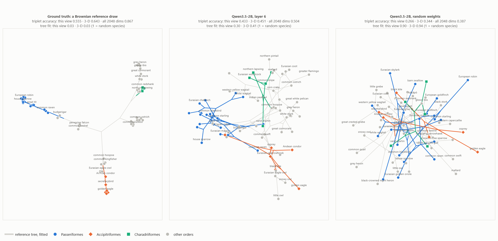</a><br><b>Birds at layer 6, each panel from the angle at the optimized viewing angle: reference, trained and random weights</b><br>⚪ example: tree fit in the best view: Brownian reference 0.03 · trained 0.30 · random weights 0.90 (1 = random species)</p>

*Generated by `python -m phylogeo.run --phases viz_data,site` from `results/`; post hoc, descriptive.* The 3-D within-group view of birds (70 species, 45 decision nodes), seen from one camera angle per panel and drawn flat. Pipeline: Qwen3.5-2B residual stream after layer 6 (the output of block 6 of 24; the H1 layer), at the last token of each species name in 8 prompts. Within each prompt the mean over all 400 species is subtracted, then the prompts are averaged. Each vector is scaled to unit length, centred on the birds and projected onto the birds' top 3 principal components. Angle rule, identical for every panel: of 2,000 evenly spread viewing directions, the one where the fitted reference tree is shortest relative to a random assignment of the species (exact expectation, no shuffles). The picture is therefore not the PC1–PC2 plane but the most tree-like view of each 3-D cloud. Random weights get their best angle too, so the comparison is not cherry-picked, but it is a display choice, not a test: the 'this view' numbers are optimistic, and the 3-D and all-dimension numbers are the fair ones. Lines: the reference tree fitted into the points, as in phylomorphospace plots (leaves at the species, ancestor nodes where the total squared edge length is smallest), coloured inside one order; branch points are fitted positions, not species. Left: an ideal tree code, one draw of Brownian motion along the reference tree in 2048 dimensions with unit edge lengths (topology only), through the same unit-length, centring, PCA and angle steps (it has no prompts). Even this code keeps only part of the tree after projection: triplet accuracy 0.867 in all 2048 dimensions, 0.643 in 3-D and 0.555 in this view. Middle: Qwen3.5-2B; right: the same architecture with freshly initialized weights, same tokenizer and pipeline. Colours: the three largest orders, gray: other orders. Names are shown where they fit (hover on the site for every name). Titles: triplet accuracy (chance 1/3) and tree fit (1 = random species) in this view, in 3-D and (accuracy) in all 2048 dimensions.
<!-- BIRDS3D:END -->

<!-- WITHIN3D:START -->
<p align="center"><b>Tree order inside groups, in 3-D: trained vs random weights, with the tree fitted in</b> (animated here; interactive on the site)<br>🟡 mixed: beats random weights in 2/4 groups in 3-D (birds, mammals), in 0/4 in all dimensions (per-group CIs)</p>

<p align="center"><a href="https://burnycoder.github.io/phylogenetic-geometry-of-tree-of-life-in-llms-mechanistic-interpretability/#fig-within3d">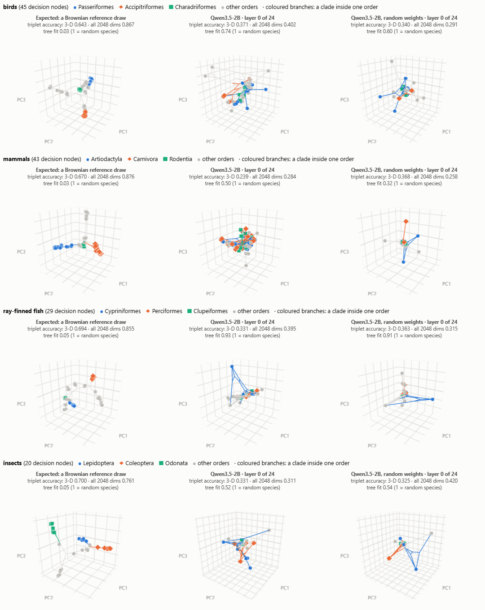</a><br><b>Through the layers: both networks sweep layers 0 → 24 (the Brownian reference has no layers); each title shows that layer's numbers</b></p>

<p align="center"><a href="https://burnycoder.github.io/phylogenetic-geometry-of-tree-of-life-in-llms-mechanistic-interpretability/#fig-within3d"></a><br><b>At the H1 layer (6), rotating; the table below is at this layer</b></p>

*Generated by `python -m phylogeo.run --phases viz_data,site` from `results/`; post hoc, descriptive.* In the layer sweep, each layer has its own projection; consecutive layers are rotated onto each other (orthogonal Procrustes, display only) and positions are interpolated between layers, so the clouds move smoothly instead of flipping axes. Groups: every group with at least 20 decision nodes in the H1 test (one row each in the static view). Left: a Brownian reference draw (Brownian motion on the reference tree), middle: Qwen3.5-2B at layer 6 (the H1 layer), right: the same network with random weights. Every panel goes through one pipeline: species vectors scaled to unit length (the geometry the cosine-based H1 test scores), centred on the group, top three principal components. Colours: the group's three largest orders; gray: all other orders. Lines: the reference tree fitted into the points (phylomorphospace: internal nodes where the total squared branch length is smallest, i.e. Brownian-motion ancestral states); branches inside one coloured order wear its colour. Titles give the triplet accuracy of the 3-D picture and of all 2048 dimensions (chance 1/3), and the tree fit: squared length of the fitted tree over its mean across 999 shuffles of the species (1 = no better than a random assignment). The tree fit uses every species, including names that share a head noun ("… beetle"), so shared words can lower it even in the random-weight network; the triplet accuracies exclude such names, as H1 does. Three dimensions keep only part of the order, even for the Brownian reference draw. Internal-node placement follows squared-change parsimony ([Maddison 1991](https://search.r-project.org/CRAN/refmans/castor/html/asr_squared_change_parsimony.html)) as in phylomorphospace plots ([Sidlauskas 2008](https://doi.org/10.1111/j.1558-5646.2008.00519.x); phytools `phylomorphospace3d`, [Revell 2012](https://doi.org/10.1111/j.2041-210X.2011.00169.x)).

| group (decision nodes) | triplet accuracy, 3-D view: trained / random weights [difference, 95% CI] | all 2048 dimensions: trained / random weights [difference, 95% CI] | tree fit, lower = better: Brownian reference / trained / random weights |
|---|---|---|---|
| birds (45) | 0.451 / 0.344 [+0.057, +0.223] | 0.504 / 0.387 [-0.034, +0.252] | 0.03 / 0.41 / 0.94 |
| mammals (43) | 0.418 / 0.281 [+0.031, +0.266] | 0.533 / 0.398 [-0.025, +0.291] | 0.03 / 0.33 / 0.48 |
| ray-finned fish (29) | 0.488 / 0.292 [-0.001, +0.357] | 0.467 / 0.336 [-0.176, +0.281] | 0.05 / 0.66 / 0.98 |
| insects (20) | 0.296 / 0.283 [-0.111, +0.211] | 0.343 / 0.410 [-0.174, +0.193] | 0.05 / 0.46 / 0.60 |

CIs: paired family-block bootstrap (1000 draws) of trained minus random weights, on the H1 triplets of each group. The difference excludes zero in 2 of 4 groups in the 3-D view and in 0 of 4 in all 2048 dimensions. Group by group, the picture therefore shows the separation more sharply than the full space does; the confirmatory evidence is the registered H1 test, which pools all groups (key-results table below).
<!-- WITHIN3D:END -->

<!-- FIGURES:START -->
*Generated by `python -m phylogeo.run --phases viz_data,site` from `results/`; click a figure for the interactive version on the [project site](https://burnycoder.github.io/phylogenetic-geometry-of-tree-of-life-in-llms-mechanistic-interpretability/) (hover, zoom, toggle series).*

<p align="center"><a href="https://burnycoder.github.io/phylogenetic-geometry-of-tree-of-life-in-llms-mechanistic-interpretability/#fig-pca3d">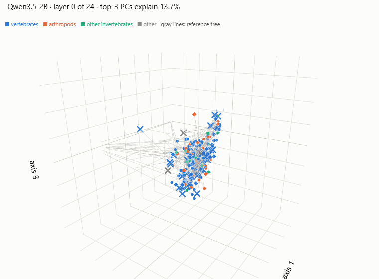</a><br><b>Top-3 principal components in 3-D, animated through all layers: trained vs random init</b> (animated here; interactive 3-D player on the site)<br>🟡 mixed: trained: H1a checks pass in 23/25 layers, already at near-lexical layer 2, so they do not discriminate; by eye: class arms, no nested branching</p>

<table>
<tr><td width="50%" valign="top"><a href="https://burnycoder.github.io/phylogenetic-geometry-of-tree-of-life-in-llms-mechanistic-interpretability/#fig-taxonomy">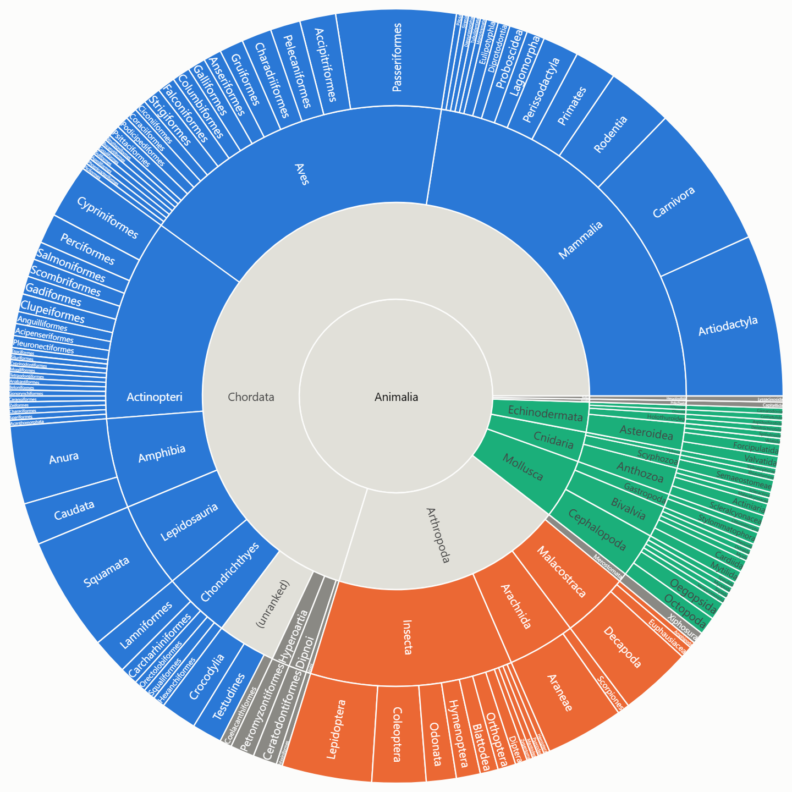</a><br><b>Ground truth: the 400 species on the tree of life</b><br>🔷 ground truth: reference</td><td width="50%" valign="top"><a href="https://burnycoder.github.io/phylogenetic-geometry-of-tree-of-life-in-llms-mechanistic-interpretability/#fig-heatmaps">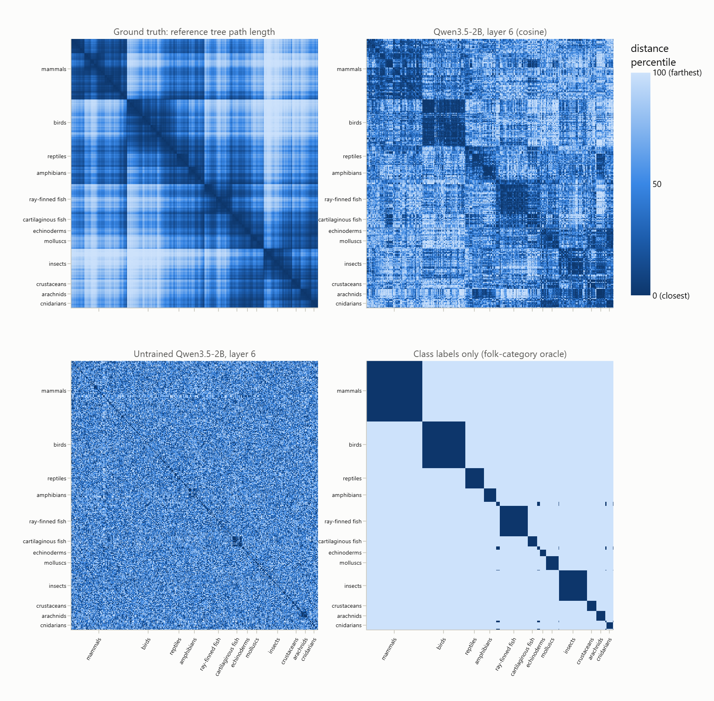</a><br><b>Expected vs observed: who is close to whom</b><br>🔷 ground truth: ground truth vs observed</td></tr>
<tr><td width="50%" valign="top"><a href="https://burnycoder.github.io/phylogenetic-geometry-of-tree-of-life-in-llms-mechanistic-interpretability/#fig-pca_expected"></a><br><b>Expected vs observed shape in the top two principal components</b><br>🟡 mixed: class arms, no visible nested tree</td><td width="50%" valign="top"><a href="https://burnycoder.github.io/phylogenetic-geometry-of-tree-of-life-in-llms-mechanistic-interpretability/#fig-h1"></a><br><b>Primary test of tree agreement within groups</b><br>✅ positive: Family-block criterion met, max-T p 0.001</td></tr>
<tr><td width="50%" valign="top"><a href="https://burnycoder.github.io/phylogenetic-geometry-of-tree-of-life-in-llms-mechanistic-interpretability/#fig-within3d"></a><br><b>Tree order inside groups, in 3-D: trained vs random weights, with the tree fitted in</b><br>🟡 mixed: beats random weights in 2/4 groups in 3-D (birds, mammals), in 0/4 in all dimensions (per-group CIs)</td><td width="50%" valign="top"><a href="https://burnycoder.github.io/phylogenetic-geometry-of-tree-of-life-in-llms-mechanistic-interpretability/#fig-layers">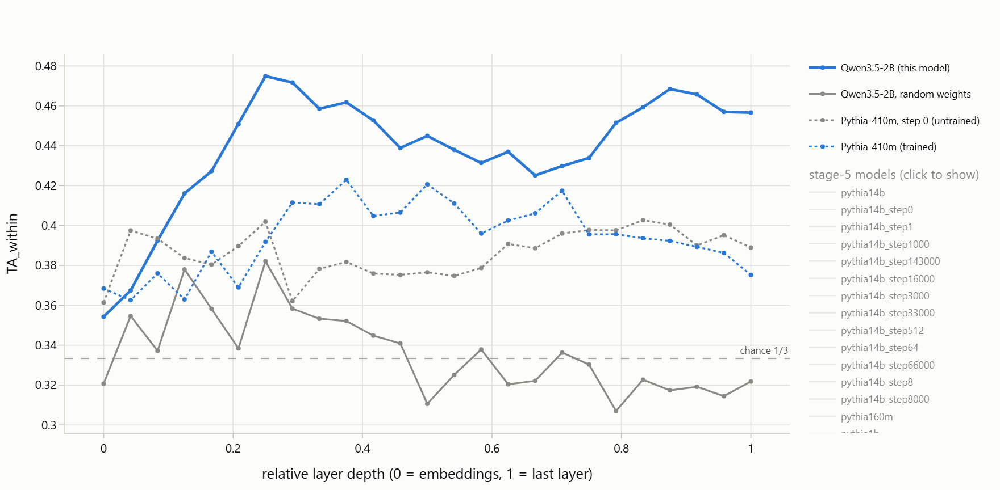</a><br><b>Across layers: when does tree order appear?</b><br>✅ positive: peaks at layer 6 of 24 (25% depth)</td></tr>
<tr><td width="50%" valign="top"><a href="https://burnycoder.github.io/phylogenetic-geometry-of-tree-of-life-in-llms-mechanistic-interpretability/#fig-strata"></a><br><b>Which groups carry the signal?</b><br>🟡 mixed: clear in birds, mammals; below chance in arachnids (3 nodes)</td><td width="50%" valign="top"><a href="https://burnycoder.github.io/phylogenetic-geometry-of-tree-of-life-in-llms-mechanistic-interpretability/#fig-depth">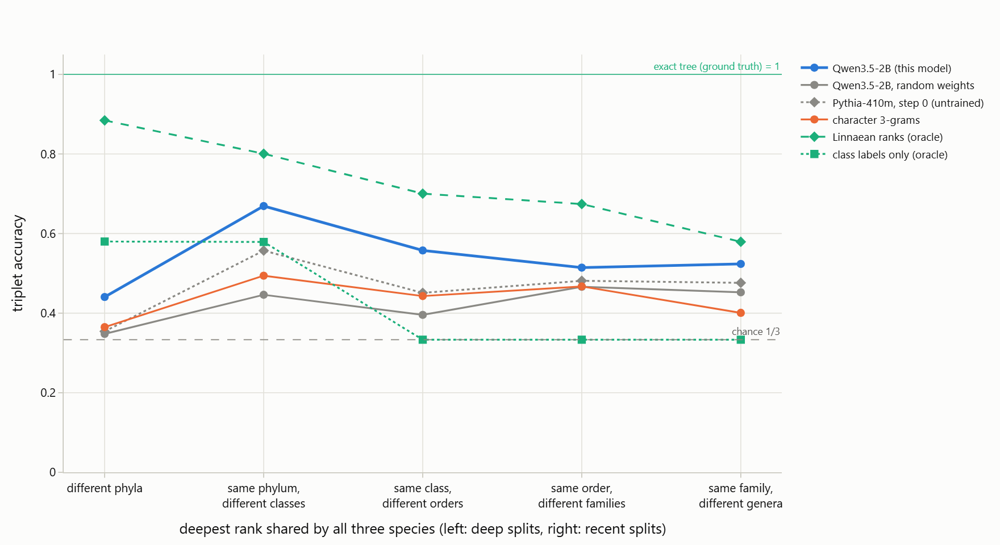</a><br><b>Where on the tree is the model right? Accuracy by depth of the split</b><br>🟡 mixed: largest gain between classes, smaller inside orders</td></tr>
<tr><td width="50%" valign="top"><a href="https://burnycoder.github.io/phylogenetic-geometry-of-tree-of-life-in-llms-mechanistic-interpretability/#fig-neighbor_levels">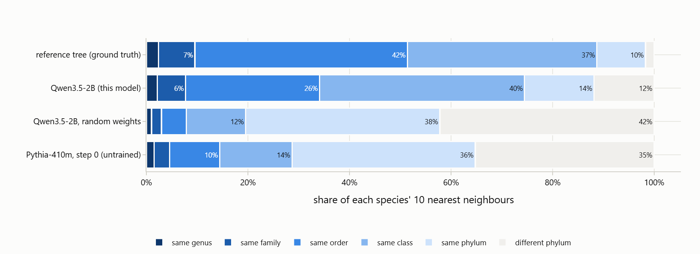</a><br><b>Nearest neighbours: how closely related are they?</b><br>✅ positive: far more same-order neighbours than untrained</td><td width="50%" valign="top"><a href="https://burnycoder.github.io/phylogenetic-geometry-of-tree-of-life-in-llms-mechanistic-interpretability/#fig-neighbor_examples">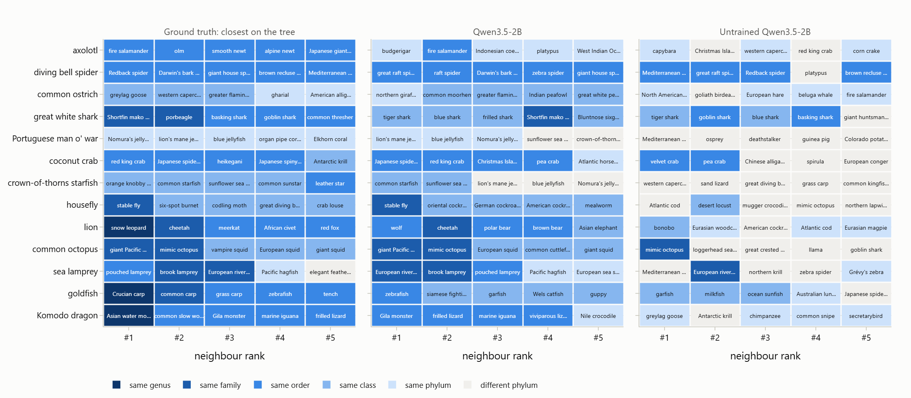</a><br><b>Output examples: the 5 nearest species</b><br>⚪ example: rule-chosen queries (one per stratum)</td></tr>
<tr><td width="50%" valign="top"><a href="https://burnycoder.github.io/phylogenetic-geometry-of-tree-of-life-in-llms-mechanistic-interpretability/#fig-secondary"></a><br><b>Within-order and lexical subsets</b><br>🟡 mixed: Conditional comparisons</td><td width="50%" valign="top"><a href="https://burnycoder.github.io/phylogenetic-geometry-of-tree-of-life-in-llms-mechanistic-interpretability/#fig-conflict">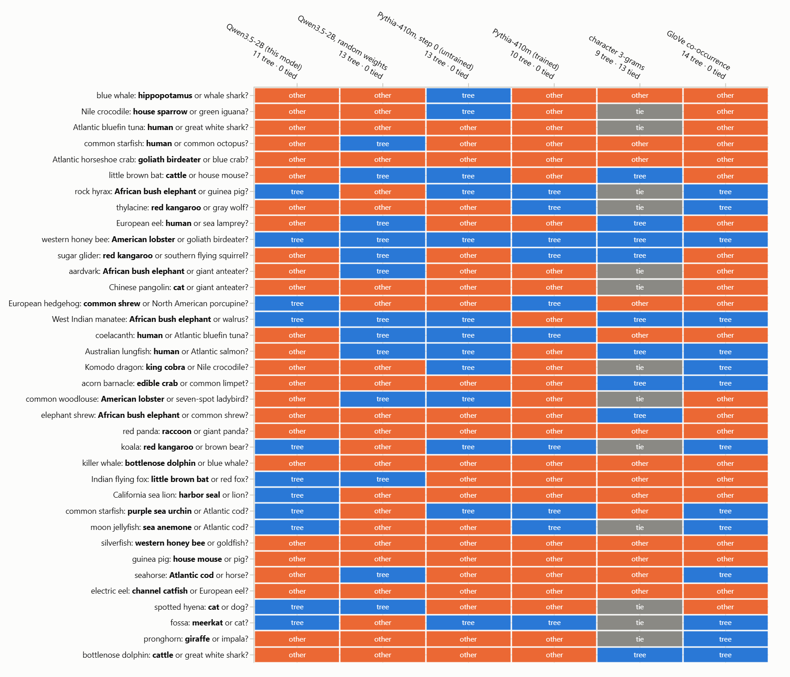</a><br><b>Tree choices on hand-picked conflict items</b><br>⚪ example: 11 tree, 0 tied, 25 other</td></tr>
<tr><td width="50%" valign="top"><a href="https://burnycoder.github.io/phylogenetic-geometry-of-tree-of-life-in-llms-mechanistic-interpretability/#fig-probe"></a><br><b>Goodfire-style 10-d flat probe: tree or coarse groups?</b><br>❌ negative: class-only input has higher mean r</td><td width="50%" valign="top"><a href="https://burnycoder.github.io/phylogenetic-geometry-of-tree-of-life-in-llms-mechanistic-interpretability/#fig-treeness"></a><br><b>Is the geometry tree-like (hyperbolic)?</b><br>❌ negative: between clusters and noise</td></tr>
<tr><td width="50%" valign="top"><a href="https://burnycoder.github.io/phylogenetic-geometry-of-tree-of-life-in-llms-mechanistic-interpretability/#fig-causal">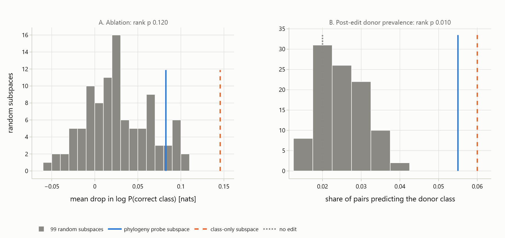</a><br><b>Ablation and donor-class predictions</b><br>🟡 mixed: Registered switch comparison unevaluable</td><td width="50%" valign="top"><a href="https://burnycoder.github.io/phylogenetic-geometry-of-tree-of-life-in-llms-mechanistic-interpretability/#fig-habitat"></a><br><b>Foraging traits on held-out species</b><br>🟡 mixed: Aquatic associations in mammals and birds</td></tr>
<tr><td width="50%" valign="top"><a href="https://burnycoder.github.io/phylogenetic-geometry-of-tree-of-life-in-llms-mechanistic-interpretability/#fig-scale"></a><br><b>Model size and checkpoint trajectories</b><br>⚪ example: Descriptive comparisons</td><td width="50%" valign="top"><a href="https://burnycoder.github.io/phylogenetic-geometry-of-tree-of-life-in-llms-mechanistic-interpretability/#fig-sensitivity"></a><br><b>Sensitivity: seeds, templates, species subsamples</b><br>⚪ example: Archived perturbations</td></tr>
</table>
<!-- FIGURES:END -->

## Hypotheses and findings

Triplet accuracy is the average, across eligible tree nodes, of how often the sister pair has the smallest representation distance. The four named controls and two added nuisance controls are compared using paired family-block intervals. The independent reanalysis records both the historical implementation and the written tie rule. Several decisions postdated exploratory observations. [Controls and sensitivity](reports/reviews/2026-11-26-scientific-audit.md#primary-geometry-and-control-comparisons) · [Registration history](reports/preregistration.md#deviations)

<!-- KEY-RESULTS:START -->
| ID | Hypothesis | Estimate | Test p | Assessment |
|---|---|---|---|---|
| H1 | Within-group rooted triples | 0.473 cross-fitted | 0.000999 | Criterion met with family blocks |
| S1 | Global edge-count association | 0.362 at layer 6 | 0.0050 | Criterion met |
| S2 | Family/genus resolution within order | 0.544 at layer 6 | 0.0050 | Criterion met |
| S3 | Unique wrong spelling choice | 0.382 at layer 6 | 0.2438 | Criterion unmet |
| S4 | Unique wrong GloVe choice | 0.372 at layer 6 | 0.2438 | Criterion unmet |
| S5 | Age given rank and MRCA depth | 0.042 at layer 6 | 0.1409 | Criterion unmet |
| C-abl | Candidate log-probability drop | 0.083 nats | 0.2400 | Criterion unmet (Holm upper bound) |
| C-swap | New donor-class answers | 7–11 / 200 | — | Paired comparison unevaluable |
| M1 | Marine versus ground mammals | 6 marine / 61 ground | 4.81e-07 | Criterion met |
| M2 | Aerial versus ground mammals | 0 aerial | — | Unevaluable |
| B1 | Bird water foraging | ρ = -0.385 | 0.000635 | Criterion met |
| B2 | Bird aerial foraging | ρ = -0.157 | 1.0000 | Criterion unmet |

H1 uses the layer maximum. Secondary and habitat rows report Holm-adjusted p-values. Secondary effects are displayed at the H1 layer; their tests cover all layers. C-swap is bounded by the observed marginals. [Audit, evidence and interpretation](https://github.com/BurnyCoder/phylogenetic-geometry-of-tree-of-life-in-llms-mechanistic-interpretability/blob/main/reports/reviews/2026-11-26-scientific-audit.md)
<!-- KEY-RESULTS:END -->

| Top-3 PCA, layer 21 (one panel per group, highlighted against all species) | Within-group triplet accuracy by layer, vs controls |
|---|---|
|  | 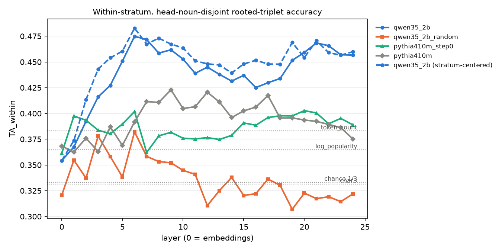 |
| **Flat-subspace probe, held-out families** | **Days of the week (calibration: a circle)** |
| 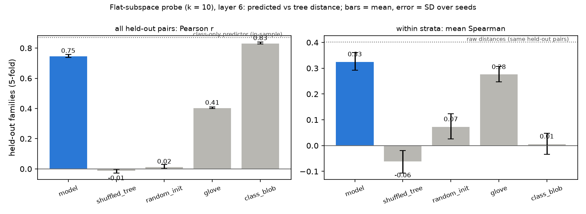 |  |

An interactive 3D version of the PCA view, with a layer slider and hover names, is at [`results/qwen35_2b/stage1a/pca3d.html`](results/qwen35_2b/stage1a/pca3d.html). The website also has an **animated 3-D player** (the GIF at the top of this README). It shows the trained model **next to its random-init twin**, both driven by one layer clock through all 25 layers. Positions are interpolated between consecutive layers, which are aligned by orthogonal Procrustes. The two cameras are linked, the panels share one box per layer, and outlier names outside the box are counted in the title. There is also a tree overlay, and the right panel can show the expected shape of a true tree code instead.

## What this study contributes

A topology-based test on common names complements previous work on organism representations and masked mammal descriptions. It includes a comparison inside the same coarse group, spelling and popularity controls, held-out-family probe measurements, and a separate test of a discovery-axis prediction on new species. The study also tests interventions on coarse-class answers. [Literature](reports/literature-review.md) · [Independent claim and source register](reports/reviews/2026-11-26-claim-sources.md)

## Method

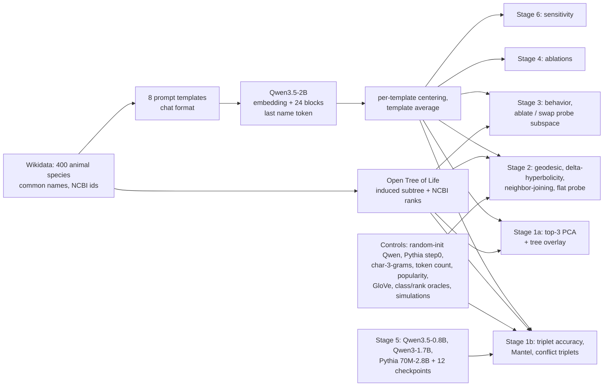


### Data
- **Species.** 400 animals across 13 coarse groups (strata), selected by a fixed rule from Wikidata via the [QLever endpoint](https://qlever.dev/wikidata):
  - the English Wikipedia title is the common name;
  - each has an NCBI taxon id and an Open Tree match;
  - at most 3 per family;
  - polysemous names such as "jaguar" are excluded.

  The list is frozen with sha256 hashes in [`data/FREEZE.json`](data/FREEZE.json).
- **Reference tree.** The induced subtree of the [Open Tree of Life](https://tree.opentreeoflife.org/) (CC0), with ranks from the [NCBI Taxonomy](https://www.ncbi.nlm.nih.gov/taxonomy). Divergence times come from [TimeTree 5](https://timetree.org/); they are used only for S5, cached locally and not redistributed.
- **Conflict triplets.** 36 hand-curated triplets where phylogeny and folk categories disagree ([`data/conflict_triplets.csv`](data/conflict_triplets.csv)).
- **Held-out habitat set.** 79 mammals and 80 birds, with foraging strata from [EltonTraits 1.0](https://esapubs.org/archive/ecol/E095/178/).

### Representations
- **Model.** [Qwen3.5-2B](https://huggingface.co/Qwen/Qwen3.5-2B), the post-trained release, pinned revision. It is a hybrid of Gated-DeltaNet and full-attention layers (24 layers, d = 2048), run in bf16 on one 8 GB GPU with batch size 1.
- **Prompts.** 8 templates in the chat format, e.g. "My favorite animal is the {name}."
- **Readout.** The residual stream at the last token of the name, at every layer.
- **Normalization.** Each template is mean-centered over species, then the templates are averaged. Distance is cosine.

### Evaluation
- **Primary metric (H1): TA_within.**
  - Rooted-triplet accuracy on triplets (a, b | c) whose three species belong to the same eligible stratum and have distinct final name words.
  - At most 200 triplets per tree node, with equal weight per eligible decision node. Chance is 1/3.
  - Tested with a max-T permutation over layers (species shuffled within strata), family-blocked cross-fitting for layer choice, and a family-block bootstrap CI.
  - H1 also requires positive paired lower confidence bounds against every required control.
- **Secondary hypotheses (Holm-corrected).** S1 Mantel, S2 order-level TA, S3 lexical-discordant TA, S4 co-occurrence-discordant TA, S5 divergence time vs topology.
- **Causal hypotheses (Holm family of 2).** Ablation and interchange of the probe subspace (stage 3).
- The habitat addendum specifies a separate family of directional tests. Other descriptive work and recorded amendments are identified in [`reports/preregistration.md`](reports/preregistration.md#deviations).

### Interpreting the controls

The six required controls leave a positive primary margin with family blocks. With orders as blocks, intervals against both untrained networks cross zero. The trained model satisfies the registered tests for overall tree distance and fine splits within orders. The lexical-discordant and GloVe-discordant tests fall short after multiplicity correction. This panel cannot identify how much co-occurrence or ecology contributed to the association. [Independent calculations](results/scientific-verification/geometry.json) · [Hypothesis decisions](results/scientific-verification/decisions.json)

## How to run

To reproduce the published tables, figures, release cards and paper from the saved evidence, install the locked environment, Pandoc, Chrome for Kaleido, and run the following command. This path uses no training or inference. For raw statistical replay, cache locations and required original files, see the [pipeline guide](docs/pipeline.md#reproducing-the-independent-audit).

```powershell
uv sync --frozen
uv run --frozen python -m phylogeo.verification --render-only
```

### Original experiment workflow


The original extraction and training workflow used Python 3.12, [uv](https://docs.astral.sh/uv/), and an NVIDIA GPU with 8 GB or more (CUDA 13 wheels support Blackwell sm_120).

```powershell
uv sync --frozen
```

```powershell
Copy-Item .env.example .env
```

Edit `.env` so that `HF_HOME` and `DATA_DIR` point to a drive with enough space: about 15 GB for the main analyses, plus about 50 GB of model checkpoints for stage 5.

```powershell
uv run pytest
```

The species set and trees are already frozen in `data/`. The rebuild below re-queries Wikidata and Open Tree, and changes the hashes if those sources changed:

```powershell
uv run python -m phylogeo.run --phases species
```

Extract activations for the main model and the controls. This needs the GPU and takes about 10 minutes per model:

```powershell
uv run python -m phylogeo.run --config configs/qwen35_2b.yaml --phases extract
```

```powershell
uv run python -m phylogeo.run --config configs/qwen35_2b_random.yaml --phases extract
```

```powershell
uv run python -m phylogeo.run --config configs/pythia410m_step0.yaml --phases extract
```

```powershell
uv run python -m phylogeo.run --config configs/pythia410m.yaml --phases extract
```

Run all analyses for the main model. Stages 3 and 4 use the GPU:

```powershell
uv run python -m phylogeo.run --config configs/qwen35_2b.yaml --phases dates,pca,power,analyze,conflict,stage2,stage3,stage4,eco,stage6
```

Stage 4 needs two extra extractions first: `--phases extract --name-sets species_sci`, and `configs/qwen35_2b_raw.yaml`. The habitat addendum needs `--phases extract --name-sets heldout_eco`.

Stage 5 runs `extract` and `scale` for each config in `configs/` (Qwen3.5-0.8B, Qwen3-1.7B, Pythia 70m–2.8b, Pythia-1.4B checkpoints), then:

```powershell
uv run python -m phylogeo.run --phases scale_summary
```

Regenerate every table, the website and the paper from `results/`:

```powershell
uv run --frozen python -m phylogeo.verification --render-only
```

`viz_data` is the only step here that reads the activations (CPU, about a minute); it writes the compact files in `results/qwen35_2b/viz/` that the interactive figures use. PNG export uses [kaleido](https://github.com/plotly/Kaleido), which needs a local Chrome.

### What happens when you run it
1. **`species`** queries Wikidata, matches names to Open Tree and NCBI, applies the selection rules, and freezes `data/species.csv` and `data/species_tree.nwk`.
2. **`extract`** renders 8 prompts per species and runs one forward pass per prompt. It stores the last-name-token and mean-name-token residual stream of every layer as float32 arrays in `DATA_DIR/activations/<run>/<name_set>/`. Extraction progress and selected prompt examples are logged to `logs/`.
3. **`pca`** produces stage-1a plots (2D, 3D, spotlight, zoom, calibration) and the H1a checks.
4. **`analyze`** samples rooted triplets from the tree and computes TA, Mantel and the controls with permutation tests and bootstrap CIs (stage 1b). **`conflict`** scores the conflict triplets.
5. **`stage2`** to **`stage6`** run the analyses described above. Each writes `results/<run>/<stage>/results.json` and figures.
6. **`report`** turns all JSON into `results/RESULTS.md`, `results/<run>/SUMMARY.md`, and the headline block of this README and of `reports/summary.md`.
7. **`viz_data`** derives tree-ordered distance percentiles, 2-D PCA coordinates (including the Brownian-motion-on-tree expectation) and every species' nearest neighbours. **`site`** builds the labelled interactive figures (`src/phylogeo/viz/figures.py`), exports their PNGs to `reports/figures/viz/`, refreshes the *Visual summary* gallery at the top of this README, and writes `site/`. **`paper`** builds `reports/paper.pdf` with [Typst](https://typst.app/).

More detail is in [docs/pipeline.md](docs/pipeline.md).

## Live training dashboard

Probe training in stage 2 streams its metrics to [trackio](https://github.com/gradio-app/trackio). The dashboard must use the same `HF_HOME` as the training process:

```powershell
$env:HF_HOME="D:/AI/hf_cache"; uv run trackio show --project phylogeo-probes
```

Then open http://127.0.0.1:7860.

## Features and technologies
- **Data:** Wikidata (QLever SPARQL), Open Tree of Life API, NCBI taxdump, TimeTree 5, EltonTraits.
- **Model and extraction:**
  - [PyTorch](https://pytorch.org/) (CUDA 13), [transformers](https://github.com/huggingface/transformers) 5.
  - Forward hooks for ablation and interchange.
  - The chat-template name span is located with tokenizer offset mappings.
- **Statistics:**
  - Rooted-triplet accuracy with node balancing.
  - Max-T permutation tests over layers; Mantel and partial Mantel; family-block bootstrap; Holm correction for confirmatory families and BH-FDR over the registered exploratory family.
- **Geometry:**
  - kNN geodesics ([scipy](https://scipy.org/)).
  - Gromov δ ([Khrulkov et al. 2020](https://arxiv.org/abs/1904.02239)).
  - Neighbor-joining ([scikit-bio](https://scikit.bio/)) and Robinson–Foulds distance ([DendroPy](https://jeetsukumaran.github.io/DendroPy/)).
  - Goodfire-style flat probe in Euclidean, angular and Poincaré variants.
- **Visualization and reporting:**
  - 18 labelled interactive [Plotly](https://plotly.com/python/) figures (ground truth, positive and negative results), each with a verdict computed from the results; PNG export with kaleido for the README.
  - An animated, interactive side-by-side 3-D view of the top-3 principal components at every layer, trained vs random-init (custom player on Plotly.js with linked cameras; animated GIF via kaleido and [Pillow](https://pillow.readthedocs.io/) for the README).
  - A nearest-neighbour explorer for all 400 species on the site; 3D PCA with a layer slider; matplotlib stage figures; trackio.
  - Colour palette validated for colour-vision deficiencies (four fixed categorical hues, one sequential blue ramp).
  - Typst paper; static GitHub Pages site.
- **Reproducibility:**
  - uv lockfile, pinned model revisions, frozen and hashed species set.
  - Seeded independent random streams.
  - A pytest suite with ground-truth statistical checks (exact tree metrics, null calibration, hook edits).

## Repository layout

```
src/phylogeo/     package: data/ (species, tree, NCBI, held-out), prompts, extract, geometry,
                  stats/ (triplets, mantel), baselines, simulate, probes/, causal, behavior,
                  analysis (stage 1b), stage2..stage6, eco, viz/, report, site, paper, run (entry point)
tests/            pytest suite
configs/          one YAML per run (model, revision, controls)
data/             frozen species set, trees, conflict and held-out sets (CC0 sources)
results/          raw results (JSON) and figures per run and stage; RESULTS.md (generated)
reports/          literature review, preregistration, plan, progress, experiments/, reviews/, paper
docs/             pipeline documentation
logs/             timestamped run logs (prompts and outputs)
```

## Data and models on Hugging Face
- Collection: [Phylogenetic geometry of the tree of life in LLMs](https://huggingface.co/collections/BurnyCoder/phylogenetic-geometry-of-the-tree-of-life-in-llms-6afffc252e04f452d5e7d905)
- Frozen species set, Open Tree trees and conflict triplets: [BurnyCoder/phylogenetic-geometry-species](https://huggingface.co/datasets/BurnyCoder/phylogenetic-geometry-species)
- Saved residual-stream activations, organized by run and available name set: [BurnyCoder/phylogenetic-geometry-activations](https://huggingface.co/datasets/BurnyCoder/phylogenetic-geometry-activations)
- Flat-subspace probe trained on all 400 species (safetensors, with PCA): [BurnyCoder/phylogeo-flat-probe-qwen3.5-2b](https://huggingface.co/BurnyCoder/phylogeo-flat-probe-qwen3.5-2b). The separate held-out fits and class-control results are described on the model card and in the paper.
- Interactive results site: https://burnycoder.github.io/phylogenetic-geometry-of-tree-of-life-in-llms-mechanistic-interpretability/

## Documentation
- [Literature review](reports/literature-review.md) · [State-of-the-art methods review](reports/state-of-the-art-review.md)
- [Preregistration and deviations](reports/preregistration.md) · [Planned runs](reports/planned-runs.md) · [Plan](reports/plan.md) · [Progress](reports/progress.md)
- [Experiments](reports/experiments/experiments.md) · [Learnings](reports/experiments/learnings.md) · [Reviews](reports/reviews/)
- [All results tables (generated)](results/RESULTS.md) · [Summary](reports/summary.md)

## To-do
- [x] Literature and state-of-the-art review; preregistration and run matrix
- [x] Tests and core implementation; species set frozen; power simulation
- [x] Stage 1a (PCA look), stage 1b (confirmatory tests), stage 2 (geometry and probes)
- [x] Stage 4 (ablations) and Addendum A (habitat axis on held-out species)
- [x] Stage 3: behaviour and corrected causal rerun with 99 random subspaces and a class-only control (deviations 19–20)
- [x] Stage 5: Qwen3.5-0.8B, Qwen3-1.7B, Pythia scale series and Pythia-1.4B training checkpoints
- [x] Stage 6: sensitivity
- [x] Independent final review (round 1) and fixes ([review](reports/reviews/2026-11-20-final-review-round1.md))
- [x] Paper, website (GitHub Pages), Hugging Face activations and probe weights
- [x] Final fact-check and red-team review ([round 1](reports/reviews/2026-11-20-final-review-round1.md), [stage-3 causal](reports/reviews/2026-11-20-stage3-causal-review.md))
- [x] [Independent scientific reanalysis, 26 November](reports/reviews/2026-11-26-scientific-audit.md), including exact frozen-file checks and a separate [source register](reports/reviews/2026-11-26-claim-sources.md).
- Next, from the audit:
  - register an order-level block bootstrap, or a hierarchical one, as the primary uncertainty estimate for any follow-up;
  - add a co-occurrence-neutral analysis, analogous to the spelling-neutral one, using Pile n-gram counts.
- Possible extensions:
  - an ecology and body-size baseline (EltonTraits trait distance) for mammals and birds, to separate ecology from phylogeny (final review S6);
  - S5 within-stratum rank bins with their own null, and a family-block bootstrap for the behavioural accuracy (final review S4, S8);
  - re-run the power simulation with at least 200 simulations per cell; the current one uses 40;
  - larger models (needs more than 8 GB);
  - a co-occurrence control from Pile n-gram counts (infini-gram);
  - steering along the probe subspace;
  - SAE features once an SAE for post-trained Qwen3.5-2B exists.

*Author: Libor "Burny" Burian.*
