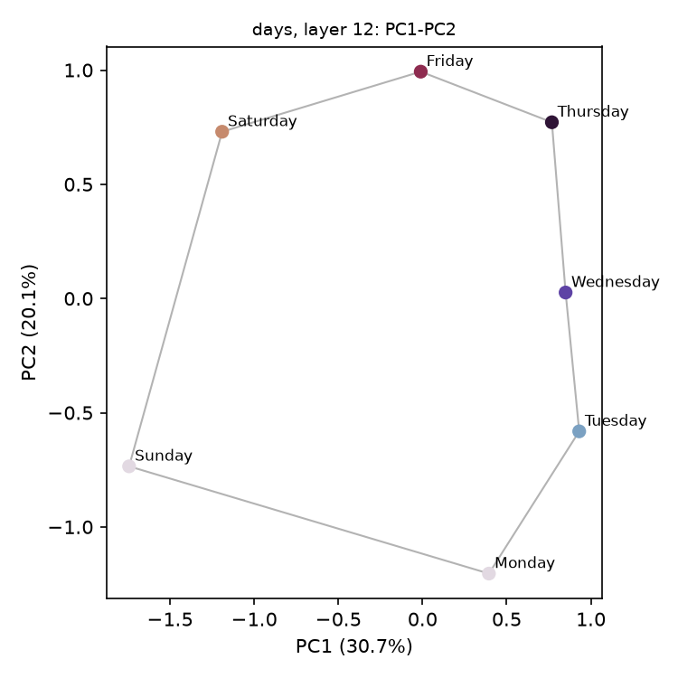
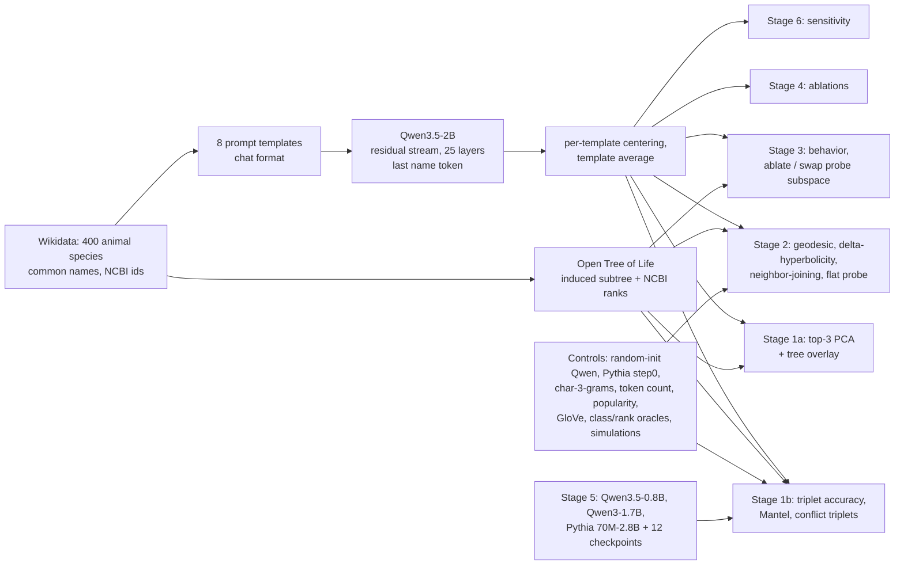

# Phylogenetic geometry of the tree of life in LLMs

**Do large language models arrange animal species along the tree of life?** This project reads the hidden states that [Qwen3.5-2B](https://huggingface.co/Qwen/Qwen3.5-2B) computes for 400 animal species names (lion, house sparrow, honey bee, …). It tests, with preregistered statistics and strong controls, whether the geometry of those representations matches the phylogenetic tree, and what shape it takes: tree, clusters, gradient or curved manifold.

The design follows Goodfire's work:
- **Evo 2 phylogeny manifold.** The DNA model Evo 2 represents bacteria on a curved manifold whose geodesics track evolutionary distance ([Goodfire 2025](https://www.goodfire.com/research/phylogeny-manifold)).
- **Neural geometry.** Concepts such as days of the week sit on simple shapes inside LLMs ([Goodfire neural geometry](https://www.goodfire.com/research/neural-geometry); [Engels et al. 2024](https://arxiv.org/abs/2405.14860); [Modell et al. 2025](https://arxiv.org/abs/2505.18235)).

This project asks the same questions of a *text* LLM. Text carries phylogeny only indirectly, so the main work is ruling out shortcuts that can mimic a tree:
- folk categories (birds, fish, bugs);
- shared words ("tiger shark", "whale shark");
- name length and popularity;
- co-occurrence statistics.

## Highlights

**Positive results**
- **There is tree order inside groups, beyond shortcuts.** Within coarse groups such as mammals or insects, Qwen3.5-2B places species closer to their true relatives more often than chance would. It also beats every preregistered control:
  - two untrained networks: random-init Qwen3.5-2B and Pythia-410m at step 0;
  - name spelling (character 3-grams);
  - name token count;
  - Wikipedia popularity.

  This was the single primary hypothesis, and it is **supported**. It holds across 20 triplet seeds, 80% species subsamples, template subsets, and even single prompt templates (stage 6).
- **A small linear subspace carries the tree.** Goodfire's 10-d "flat subspace" probe, trained on some families, predicts tree distances on held-out families far better than a shuffled-tree probe or the same probe on GloVe word vectors. It also ranks species *within* a group.
- **The dominant late-layer direction is ecology, not phylogeny.** The top principal component runs from aquatic to terrestrial animals. This was confirmed out of sample on 159 new species (preregistered addendum). Whales and seals sit toward fish, and waterbirds sit apart from other birds.
- **Calibration.** Days of the week and months form circles with the same pipeline, replicating [Engels et al.](https://arxiv.org/abs/2405.14860).

**Negative results** (preregistered predictions that failed)
- **Shortcuts are not ruled out.** The effect is not significant on triplets where name spelling or GloVe co-occurrence points the wrong way. So it cannot be shown to go beyond lexical and co-occurrence statistics (S3 and S4 not supported).
- **No time signal.** Distances do not track divergence *time* beyond tree topology (S5 not supported).
- **Folk beats phylogeny on conflict cases.** Where phylogeny and folk categories disagree (whale: hippo or whale shark? starfish: human or octopus?), the geometry follows the folk or ecological partner significantly more often than the tree.
- **No visible tree.** The top-3 PCA plots show class "arms" plus a habitat gradient, not a nested tree.
- **No hyperbolic or geodesic advantage.** A hyperbolic (Poincaré) probe is never better than a flat one, and kNN-geodesic distances do not order triplets better than plain angles.
- **Latin binomials carry no structure.** The tree order is tied to vernacular names.

The headline numbers below are generated from `results/` by the report script.

<!-- KEY-RESULTS:START -->
*Qwen3.5-2B unless noted. Generated by `python -m phylogeo.run --phases report` from `results/`; do not edit by hand.*

| Question | Result | Verdict |
|---|---|---|
| Tree order *within* coarse groups, beyond names and popularity (H1, primary) | TA_within at layer 6 = 0.475 [95% CI 0.427, 0.535], cross-fitted 0.473; max-T p <0.001; strongest required control pythia410m_step0 0.402; chance 0.333 | supported |
| Global distance correlation with the tree (S1) | Mantel Spearman r = 0.362, Holm p 0.005 | supported |
| Order within taxonomic orders (S2) | TA = 0.445, Holm p 0.005 | supported |
| Survives when spelling points the wrong way (S3) | TA = 0.382, Holm p 0.360 | not supported |
| Survives when GloVe co-occurrence points the wrong way (S4) | TA = 0.372, Holm p 0.360 | not supported |
| Distances track divergence time beyond topology (S5) | partial Spearman 0.042, Holm p 0.360 | not supported |
| Phylogeny-vs-folk conflict triplets (whale: hippo or whale shark?) | representation picks the tree-closer animal in 11/36 (binomial p 0.029) | follows the folk/ecological partner |
| Learned 10-d flat subspace generalizes to held-out families (exploratory) | held-out r = 0.749 ± 0.010 vs shuffled tree -0.015, GloVe input 0.405 | exploratory |
| Tree-like (hyperbolic) metric (exploratory) | Gromov δ_rel = 0.322 vs matched Gaussian 0.460, class-blob 0.188, exact tree 0 | exploratory |
| The model *says* which species are related (exploratory) | chooses the tree-closer animal in 0.567 of 300 within-group triplets (binomial p 0.024) | exploratory |
| Latin binomials carry the same structure (exploratory) | TA 0.332 vs common names on the same triplets 0.530 | no |
| Late-layer top PC is an aquatic ↔ terrestrial habitat axis (Addendum A, held-out species) | marine vs ground mammals Holm p <0.001; waterbird ρ = -0.385 (Holm p <0.001); aerial birds ρ = -0.157 | aquatic end supported, aerial end not |
| Robust to seeds, template subsets, species subsamples (stage 6) | lowest TA_within over 20 repetitions of each perturbation 0.437; smallest margin over the best control 0.044 | robust |
<!-- KEY-RESULTS:END -->

| Top-3 PCA, layer 21 (one panel per group, highlighted against all species) | Within-group triplet accuracy by layer, vs controls |
|---|---|
|  |  |
| **Flat-subspace probe, held-out families** | **Days of the week (calibration: a circle)** |
|  |  |

An interactive 3D version of the PCA view, with a layer slider and hover names, is at [`results/qwen35_2b/stage1a/pca3d.html`](results/qwen35_2b/stage1a/pca3d.html). It is also on the project website (GitHub Pages).

## What is new

According to the [literature review](reports/literature-review.md), no peer-reviewed study had tested whether a text LLM's internal representations of species follow the tree of life. The closest related work:
- a student project that found sentence embeddings uncorrelated with the mammal tree ([phylotext-mammals](https://github.com/jadencutinha/phylotext-mammals));
- a small 87-organism repository ([llm_internal_representations](https://github.com/alexgarciaduran/llm_internal_representations)).

This project adds:
1. **A preregistered within-group metric.** Node-balanced rooted-triplet accuracy that is immune to class-level clustering, with untrained-network, lexical, popularity and co-occurrence controls.
2. **Goodfire's flat-subspace probe in a text LLM,** with family-held-out evaluation and a shuffled-tree selectivity control.
3. **Causal tests.** The probe subspace is ablated and swapped against 99 variance-matched random subspaces.
4. **An out-of-sample test of a post-hoc observation.** The habitat axis was turned into a preregistered addendum and tested on new species.

## Method




### Data
- **Species.** 400 animals across 13 coarse groups (strata), selected by a fixed rule from Wikidata via the [QLever endpoint](https://qlever.dev/wikidata):
  - the English Wikipedia title is the common name;
  - each has an NCBI taxon id and an Open Tree match;
  - at most 3 per family;
  - polysemous names such as "jaguar" are excluded.

  The list is frozen with sha256 hashes in [`data/FREEZE.json`](data/FREEZE.json).
- **Reference tree.** The induced subtree of the [Open Tree of Life](https://tree.opentreeoflife.org/) (CC0), with ranks from the [NCBI Taxonomy](https://www.ncbi.nlm.nih.gov/taxonomy). Divergence times come from [TimeTree 5](https://timetree.org/); they are used only for S5, cached locally and not redistributed.
- **Conflict triplets.** 36 hand-curated triplets where phylogeny and folk categories disagree ([`data/conflict_triplets.csv`](data/conflict_triplets.csv)).
- **Held-out habitat set.** 79 mammals and 80 birds, with foraging strata from [EltonTraits 1.0](https://esapubs.org/archive/ecol/E095/178/).

### Representations
- **Model.** [Qwen3.5-2B](https://huggingface.co/Qwen/Qwen3.5-2B), the post-trained release, pinned revision. It is a hybrid of Gated-DeltaNet and full-attention layers (24 layers, d = 2048), run in bf16 on one 8 GB GPU with batch size 1.
- **Prompts.** 8 templates in the chat format, e.g. "My favorite animal is the {name}."
- **Readout.** The residual stream at the last token of the name, at every layer.
- **Normalization.** Each template is mean-centered over species, then the templates are averaged. Distance is cosine.

### Evaluation
- **Primary metric (H1): TA_within.**
  - Rooted-triplet accuracy on triplets (a, b | c) whose decision node lies inside one stratum and whose three names share no head noun.
  - At most 200 triplets per tree node, so no single clade dominates. Chance is 1/3.
  - Tested with a max-T permutation over layers (species shuffled within strata), family-blocked cross-fitting for layer choice, and a family-block bootstrap CI.
  - H1 requires beating the fixed control set listed under Highlights.
- **Secondary hypotheses (Holm-corrected).** S1 Mantel, S2 order-level TA, S3 lexical-discordant TA, S4 co-occurrence-discordant TA, S5 divergence time vs topology.
- **Causal hypotheses (Holm family of 2).** Ablation and interchange of the probe subspace (stage 3).
- Everything else is exploratory and labeled as such. All deviations from the preregistration are listed, with timestamps, in [`reports/preregistration.md`](reports/preregistration.md#deviations).

### Comparing the model with baselines and controls, in plain words
- **Better than all untrained networks and name-based shortcuts.** Qwen3.5-2B beats them on within-group order. The untrained networks are themselves above chance, because a random network still maps similar token strings to similar vectors. That is why they are required controls.
- **Far from an oracle.** It is well below an oracle that knows only Linnaean ranks, so the tree order is real but partial.
- **Better than GloVe.** It beats static GloVe word vectors on the primary metric, and as probe input on held-out families. It does *not* survive on triplets where GloVe disagrees with the tree.
- **Normalization and format barely matter.** Centering within strata, z-scoring dimensions and dropping the chat template leave the result essentially unchanged. Raw cosine without centering and averaging over all name tokens are worse.

## How to run

Requirements: Windows or Linux, Python 3.12, [uv](https://docs.astral.sh/uv/), and an NVIDIA GPU with 8 GB or more (CUDA 13 wheels support Blackwell sm_120).

```powershell
uv sync
```

```powershell
Copy-Item .env.example .env
```

Edit `.env` so that `HF_HOME` and `DATA_DIR` point to a drive with enough space: about 15 GB for the main analyses, plus about 50 GB of model checkpoints for stage 5.

```powershell
uv run pytest
```

The species set and trees are already frozen in `data/`. The rebuild below re-queries Wikidata and Open Tree, and changes the hashes if those sources changed:

```powershell
uv run python -m phylogeo.run --phases species
```

Extract activations for the main model and the controls. This needs the GPU and takes about 10 minutes per model:

```powershell
uv run python -m phylogeo.run --config configs/qwen35_2b.yaml --phases extract
```

```powershell
uv run python -m phylogeo.run --config configs/qwen35_2b_random.yaml --phases extract
```

```powershell
uv run python -m phylogeo.run --config configs/pythia410m_step0.yaml --phases extract
```

```powershell
uv run python -m phylogeo.run --config configs/pythia410m.yaml --phases extract
```

Run all analyses for the main model. Stages 3 and 4 use the GPU:

```powershell
uv run python -m phylogeo.run --config configs/qwen35_2b.yaml --phases dates,pca,power,analyze,conflict,stage2,stage3,stage4,eco,stage6
```

Stage 4 needs two extra extractions first: `--phases extract --name-sets species_sci`, and `configs/qwen35_2b_raw.yaml`. The habitat addendum needs `--phases extract --name-sets heldout_eco`.

Stage 5 runs `extract` and `scale` for each config in `configs/` (Qwen3.5-0.8B, Qwen3-1.7B, Pythia 70m–2.8b, Pythia-1.4B checkpoints), then:

```powershell
uv run python -m phylogeo.run --phases scale_summary
```

Regenerate every table, the website and the paper from `results/`:

```powershell
uv run python -m phylogeo.run --config configs/qwen35_2b.yaml --phases report,site,paper
```

### What happens when you run it
1. **`species`** queries Wikidata, matches names to Open Tree and NCBI, applies the selection rules, and freezes `data/species.csv` and `data/species_tree.nwk`.
2. **`extract`** renders 8 prompts per species and runs one forward pass per prompt. It stores the last-name-token and mean-name-token residual stream of every layer as float32 arrays in `DATA_DIR/activations/<run>/<name_set>/`. Every prompt and its name tokens is logged to `logs/`.
3. **`pca`** produces stage-1a plots (2D, 3D, spotlight, zoom, calibration) and the H1a checks.
4. **`analyze`** samples rooted triplets from the tree and computes TA, Mantel and the controls with permutation tests and bootstrap CIs (stage 1b). **`conflict`** scores the conflict triplets.
5. **`stage2`** to **`stage6`** run the analyses described above. Each writes `results/<run>/<stage>/results.json` and figures.
6. **`report`** turns all JSON into `results/RESULTS.md`, `results/<run>/SUMMARY.md`, and the headline block of this README and of `reports/summary.md`. **`site`** builds `site/`. **`paper`** builds `reports/paper.pdf` with [Typst](https://typst.app/).

More detail is in [docs/pipeline.md](docs/pipeline.md).

## Live training dashboard

Probe training in stage 2 streams its metrics to [trackio](https://github.com/gradio-app/trackio). The dashboard must use the same `HF_HOME` as the training process:

```powershell
$env:HF_HOME="D:/AI/hf_cache"; uv run trackio show --project phylogeo-probes
```

Then open http://127.0.0.1:7860.

## Features and technologies
- **Data:** Wikidata (QLever SPARQL), Open Tree of Life API, NCBI taxdump, TimeTree 5, EltonTraits.
- **Model and extraction:**
  - [PyTorch](https://pytorch.org/) (CUDA 13), [transformers](https://github.com/huggingface/transformers) 5.
  - Forward hooks for ablation and interchange.
  - The chat-template name span is located with tokenizer offset mappings.
- **Statistics:**
  - Rooted-triplet accuracy with node balancing.
  - Max-T permutation tests over layers; Mantel and partial Mantel; family-block bootstrap; Holm and BH corrections.
- **Geometry:**
  - kNN geodesics ([scipy](https://scipy.org/)).
  - Gromov δ ([Khrulkov et al. 2020](https://arxiv.org/abs/1904.02239)).
  - Neighbor-joining ([scikit-bio](https://scikit.bio/)) and Robinson–Foulds distance ([DendroPy](https://jeetsukumaran.github.io/DendroPy/)).
  - Goodfire-style flat probe in Euclidean, angular and Poincaré variants.
- **Visualization and reporting:**
  - matplotlib, Plotly (3D, layer slider), trackio.
  - Typst paper; static GitHub Pages site.
- **Reproducibility:**
  - uv lockfile, pinned model revisions, frozen and hashed species set.
  - Seeded independent random streams.
  - A pytest suite with ground-truth statistical checks (exact tree metrics, null calibration, hook edits).

## Repository layout

```
src/phylogeo/     package: data/ (species, tree, NCBI, held-out), prompts, extract, geometry,
                  stats/ (triplets, mantel), baselines, simulate, probes/, causal, behavior,
                  analysis (stage 1b), stage2..stage6, eco, viz/, report, site, paper, run (entry point)
tests/            pytest suite
configs/          one YAML per run (model, revision, controls)
data/             frozen species set, trees, conflict and held-out sets (CC0 sources)
results/          raw results (JSON) and figures per run and stage; RESULTS.md (generated)
reports/          literature review, preregistration, plan, progress, experiments/, reviews/, paper
docs/             pipeline documentation
logs/             timestamped run logs (prompts and outputs)
```

## Data and models on Hugging Face
- Collection: [Phylogenetic geometry of the tree of life in LLMs](https://huggingface.co/collections/BurnyCoder/phylogenetic-geometry-of-the-tree-of-life-in-llms-6afffc252e04f452d5e7d905)
- Frozen species set, Open Tree trees and conflict triplets: [BurnyCoder/phylogenetic-geometry-species](https://huggingface.co/datasets/BurnyCoder/phylogenetic-geometry-species)

## Documentation
- [Literature review](reports/literature-review.md) · [State-of-the-art methods review](reports/state-of-the-art-review.md)
- [Preregistration and deviations](reports/preregistration.md) · [Planned runs](reports/planned-runs.md) · [Plan](reports/plan.md) · [Progress](reports/progress.md)
- [Experiments](reports/experiments/experiments.md) · [Learnings](reports/experiments/learnings.md) · [Reviews](reports/reviews/)
- [All results tables (generated)](results/RESULTS.md) · [Summary](reports/summary.md)

## To-do
- [x] Literature and state-of-the-art review; preregistration and run matrix
- [x] Tests and core implementation; species set frozen; power simulation
- [x] Stage 1a (PCA look), stage 1b (confirmatory tests), stage 2 (geometry and probes)
- [x] Stage 4 (ablations) and Addendum A (habitat axis on held-out species)
- [ ] Stage 3: corrected causal rerun with 99 random subspaces (deviation 19)
- [ ] Stage 5: Qwen3.5-0.8B, Qwen3-1.7B, Pythia scale series and Pythia-1.4B training checkpoints
- [ ] Stage 6: sensitivity (running)
- [ ] Paper, website (GitHub Pages), Hugging Face activations and probe weights
- [ ] Final fact-check and red-team review
- Possible extensions:
  - larger models (needs more than 8 GB);
  - a co-occurrence control from Pile n-gram counts (infini-gram);
  - steering along the probe subspace;
  - SAE features once an SAE for post-trained Qwen3.5-2B exists.

*Author: Libor "Burny" Burian.*
